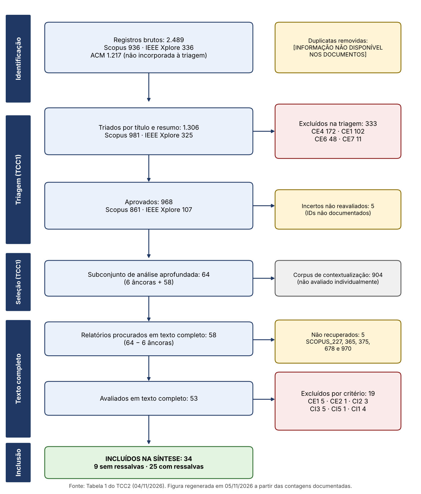

# Nota de versão (retirar antes do envio final)

Versão consolidada de 04/11/2026. Todos os números foram recalculados a partir da planilha final (`TCC2_Planilha_Final_Incluidos_Excluidos.xlsx`) e das fichas F01–F30. Onde um dado não existe nos documentos do projeto, o texto traz **[INFORMAÇÃO NÃO DISPONÍVEL NOS DOCUMENTOS FORNECIDOS]**. Nenhuma decisão aqui substitui a confirmação formal da orientadora; as decisões que dependem dela estão no relatório de pendências. A formatação segue a estrutura do TCC1; o modelo LaTeX da UNIPAMPA (`pampa-template`/`abntex2cite`) não estava disponível no ambiente, de modo que a diagramação final deve ser feita no modelo oficial.

# Resumo

Este trabalho dá continuidade ao TCC1, que mapeou a literatura secundária sobre inteligência artificial (IA) no ensino superior. Realiza-se aqui uma revisão terciária: a análise em texto completo de 58 relatórios do subconjunto de 64 estudos selecionado no TCC1 (excluídas as seis âncoras já avaliadas), conduzida segundo o protocolo da revisão, o PRISMA 2020 e as diretrizes de Kitchenham e Charters. Cinco textos não foram recuperados. Dos 53 avaliados, 34 atenderam aos critérios (9 sem ressalvas e 25 com ressalvas registradas) e 19 foram excluídos por critério. Trinta e três dos 34 foram publicados entre 2024 e 2026 e um, em 2019. A qualidade metodológica, avaliada por oito critérios (Q1–Q8, escala de 0 a 8), teve média de 5,87; 17 dos 33 estudos com o critério aplicável não avaliaram a qualidade dos estudos primários. A IA generativa e os chatbots predominam entre as aplicações (22 e 13 estudos). Vinte e dois estudos apresentam magnitudes de efeito (valores globais de 0,392 a 1,14 em g, d, SMD e ES, e de 0,127 a 0,407 em correlações); esses valores não são comparáveis entre si, e há heterogeneidade alta, sinais de viés de publicação e ausência de acompanhamento de longo prazo. Privacidade, dependência, carência de letramento e políticas, viés e integridade acadêmica são os riscos mais citados. A partir dos achados, propõe-se um framework conceitual de oito dimensões para governança e uso responsável da IA em instituições de ensino superior. O framework é uma proposta: não foi implementado nem validado, e sua validação depende de trabalho futuro. Os resultados descrevem a literatura secundária disponível e não permitem concluir que a IA melhora a aprendizagem em geral.

**Palavras-chave:** inteligência artificial; ensino superior; revisão terciária; meta-análise; PRISMA 2020; governança.

# Abstract

This work continues TCC1, which mapped the secondary literature on artificial intelligence (AI) in higher education. It reports a tertiary review: full-text analysis of 58 reports from the 64-study subset selected in TCC1 (excluding the six anchor studies already appraised there), conducted under the review protocol, PRISMA 2020 and Kitchenham and Charters. Five full texts could not be retrieved. Of the 53 appraised reports, 34 met the criteria (9 without caveats and 25 with recorded caveats) and 19 were excluded by criterion. Thirty-three of the 34 were published between 2024 and 2026 and one in 2019. Methodological quality (eight criteria, 0–8 scale) averaged 5,87; 17 of the 33 studies for which the criterion applies did not appraise the quality of primary studies. Generative AI and chatbots dominate the applications (22 and 13 studies). Twenty-two studies present effect magnitudes (overall values of 0.392 to 1.14 in g, d, SMD and ES, and 0.127 to 0.407 in correlations); these values cannot be compared, and there is high heterogeneity, signs of publication bias and no long-term follow-up. Privacy, dependence, the lack of literacy and policies, bias and academic integrity are the most cited risks. From these findings, a conceptual framework of eight dimensions for AI governance in higher education institutions is proposed. It is a proposal: it was neither implemented nor validated. The results describe the available secondary literature and do not support the claim that AI improves learning in general.

**Keywords:** artificial intelligence; higher education; tertiary review; meta-analysis; PRISMA 2020; governance.

# 1 Introdução

A IA, em especial a generativa, entrou nas atividades de ensino, avaliação e gestão das instituições de ensino superior (IES) em poucos anos. A produção científica sobre o tema cresceu na mesma velocidade, e hoje há revisões sistemáticas, meta-análises, scoping reviews e revisões guarda-chuva sobre o assunto. Essas revisões usam bases, critérios e métricas diferentes, e seus achados nem sempre concordam. Uma revisão terciária permite ver o que o conjunto dessas revisões sustenta, onde elas divergem e com que qualidade foram feitas.

O TCC1 organizou o corpus: partiu de 2.489 registros brutos nas bases do protocolo, triou 1.306 por título e resumo, aprovou 968, selecionou 64 estudos para análise aprofundada e avaliou a qualidade metodológica de seis deles (as âncoras). O TCC1 declarou que a análise individual dos demais estudos, a síntese e a proposta de um framework ficariam para o TCC2. Este trabalho cumpre essa etapa para os 58 estudos restantes.

**Objetivo geral.** Sintetizar, por meio de uma revisão terciária, o que as revisões secundárias disponíveis relatam sobre o uso de IA no ensino superior, avaliando a qualidade metodológica dessas revisões, e propor, a partir dos achados, um framework conceitual de governança.

**Objetivos específicos.**

1. Aplicar os critérios do protocolo aos relatórios em texto completo e documentar cada decisão de inclusão e exclusão.
2. Avaliar a qualidade metodológica dos estudos incluídos com o instrumento Q1–Q8.
3. Sintetizar, por questão de pesquisa, as aplicações, os benefícios relatados, os desafios e as lacunas.
4. Propor um framework conceitual e declarar o que seria necessário para validá-lo.

**Questões de pesquisa.** As quatro questões são as mesmas do TCC1, onde aparecem como QP1–QP4; neste trabalho adota-se o rótulo RQ1–RQ4 (o protocolo usa RQ1–RQ4; a unificação do rótulo é registrada como esclarecimento ao TCC1).

- **RQ1.** Quais são as principais aplicações de IA no ensino superior relatadas pelas revisões?
- **RQ2.** Quais benefícios as revisões relatam?
- **RQ3.** Quais desafios, limitações metodológicas e preocupações éticas as revisões relatam?
- **RQ4.** Quais lacunas e tendências de pesquisa as revisões indicam?

**Estrutura.** A Seção 2 apresenta a fundamentação. A Seção 3 descreve o método e sua relação com o TCC1. A Seção 4 traz os resultados por questão. A Seção 5 discute os achados. A Seção 6 apresenta a proposta conceitual. A Seção 7 reúne as limitações e a Seção 8, as considerações finais.

# 2 Fundamentação

**Revisão terciária.** Uma revisão terciária sintetiza revisões secundárias. Kitchenham e Charters (2007) tratam do processo de revisão sistemática em engenharia de software e admitem estudos terciários como forma de resumir revisões existentes; o presente trabalho segue esse processo (protocolo, critérios explícitos, extração padronizada e avaliação de qualidade) e o relato do PRISMA 2020 (PAGE et al., 2021).

**Avaliação de qualidade das revisões.** O instrumento Q1–Q8 é inspirado no AMSTAR 2 (SHEA et al., 2017), que avalia revisões que incluem estudos de intervenção em saúde. A adaptação ao ensino superior e a escala (Sim 1,0; Parcial 0,5; Não 0; máximo 8,0) foram definidas no protocolo e no TCC1. Como o AMSTAR 2 não foi concebido para esse campo, a nota serve para comparar as revisões entre si e não como medida absoluta de qualidade.

**Revisões anteriores usadas como âncoras no TCC1.** O TCC1 avaliou seis revisões: Bond et al. (2024), Kovalainen et al. (2025), Chong et al. (2025), Fu e Weng (2024), Fu, Weng e Wang (2025) e Rehman et al. (2025), com nota média de 6,75. Elas descrevem predominância de aprendizagem adaptativa e personalizada, feedback automatizado e heterogeneidade metodológica das revisões, além de integridade acadêmica e viés algorítmico como preocupações. Neste trabalho elas servem de contexto para comparação qualitativa (Seção 5.6) e não compõem a síntese.

**Concordância entre avaliações.** O TCC1 mediu a concordância intra-avaliador na triagem com o coeficiente kappa de Cohen e interpretou o valor segundo a escala de Landis e Koch (1977). O resultado (κ = 0,466, concordância moderada) está abaixo do mínimo de 0,60 fixado no protocolo, o que é tratado como limitação na Seção 7.

# 3 Método

## 3.1 Delineamento e relação com o TCC1

O estudo é uma revisão terciária, conduzida em duas etapas encadeadas. A **etapa de identificação e triagem** foi realizada no TCC1; a **etapa de elegibilidade, avaliação de qualidade, extração e síntese** é realizada neste trabalho. Para que a continuidade fique verificável, a relação entre os conjuntos de estudos é descrita a seguir e confirmada nos IDs, títulos e autores das fichas, e não pela coincidência de números.

1. **Identificação (TCC1).** O protocolo (disponível em https://github.com/Luizavfig/rst-ai-ensino-superior) registra 2.489 registros brutos (Scopus 936; IEEE Xplore 336; ACM 1.217). A triagem por título e resumo processou 1.306 registros (Scopus 981; IEEE Xplore 325). A ACM não foi incorporada à triagem. O protocolo prevê a remoção de duplicatas pela ferramenta Rayyan e o registro da data de execução em um relatório de execução da busca; esse relatório, o número de duplicatas removidas, a ferramenta efetivamente usada e a data da busca não constam dos documentos: [INFORMAÇÃO NÃO DISPONÍVEL NOS DOCUMENTOS FORNECIDOS].
2. **Triagem por título e resumo (TCC1).** Dos 1.306, 968 foram aprovados (Scopus 861; IEEE Xplore 107), 333 excluídos (CE4: 172; CE1: 102; CE6: 48; CE7: 11) e 5 ficaram incertos. Pelo protocolo (§4.3), os incertos seriam promovidos ao texto completo; o TCC1 registra que não foram reavaliados, o que é um desvio inventariado (Apêndice D). Os documentos não identificam esses 5 registros pelo ID.
3. **Seleção para análise aprofundada (TCC1).** Dos 968, o TCC1 selecionou 74 estudos por hierarquia de evidência, com base no tipo de estudo inferido de título e resumo, e chegou a 64 após ajustes (74 − 11 + 1). Os 904 restantes formam o corpus de contextualização, que não foi avaliado individualmente.
4. **Âncoras (TCC1).** Seis dos 64 foram avaliados por Q1–Q8 no TCC1: SCOPUS_657, 388, 473, 967, 374 e 412 (média 6,75). Elas foram usadas para fundamentar as inferências do TCC1 e não são recolhidas de novo neste trabalho: não há PDF nem ficha F01–F30 delas no TCC2, e as notas por item não estão registradas, de modo que só o total é comparável. O papel das âncoras no TCC2 é, portanto, de contexto e de comparação qualitativa, e não de calibração do instrumento nem de componente da síntese.
5. **Corpus deste trabalho.** Os 58 estudos restantes (64 menos as 6 âncoras) foram procurados em texto completo. Cinco textos não foram recuperados (SCOPUS_227, 365, 375, 678 e 970) e 53 foram lidos e avaliados.

Duas coincidências numéricas não indicam identidade de conjuntos. (i) O estrato "Demais" da tabela do corpus do TCC1 tem 58 linhas, mas inclui quatro das âncoras (SCOPUS_412, 473, 374 e 967) e não inclui quatro estudos do estrato "Umbrella" (SCOPUS_12, 15, 289 e 531); os 58 deste trabalho são 64 menos as seis âncoras. (ii) Há dois conjuntos de "cinco": os 5 registros incertos da triagem e os 5 textos não recuperados. Os documentos não permitem afirmar que sejam os mesmos ou diferentes: [INFORMAÇÃO NÃO DISPONÍVEL NOS DOCUMENTOS FORNECIDOS]. Neste texto, cada um tem nome próprio.

## 3.2 Critérios de elegibilidade

Os critérios são os do protocolo da revisão e foram aplicados sem alteração.

| Código | Critério |
|---|---|
| CI1 | Publicado entre 2019 e 2026 (corte de busca em 31/03/2026; estudos publicados depois não foram considerados) |
| CI2 | Estudo secundário concluído (revisão sistemática, mapeamento, scoping, integrativa com protocolo explícito, meta-análise ou terciária). Autodenominação sem bases, string e critérios é insuficiente |
| CI3 | Foco temático central em IA no ensino superior (em estudos de vários níveis, extrair apenas o ensino superior; se não separável, registrar em F30) |
| CI4 | Periódico ou anais de conferência com revisão formal |
| CI5 | Texto completo em inglês ou português |
| CE1 | Estudos primários (experimentos, estudos de caso, surveys) sem protocolo formal de revisão |
| CE2 | Revisões narrativas, capítulos de revisão e sínteses temáticas sem protocolo de busca explícito e reproduzível |
| CE3 | Estudo duplicado |
| CE4 | Protocolo: escopo não abrange o ensino superior (Educação Básica, Técnica, Média ou treinamento corporativo). TCC1: foco principal fora do escopo de IA no ensino superior |
| CE5 | Texto completo inacessível após as três vias do §4.4 do protocolo (repositório dos autores; portais abertos; e-mail ao autor correspondente, prazo de 15 dias) |
| CE6 | Capítulos de livro, editoriais, cartas, relatórios técnicos, trabalhos de conclusão e preprints sem versão publicada e revisada |
| CE7 | Publicado antes de 2019 ou data não verificável (espelho de CI1 pelo limite inferior) |

**Regras de aplicação** (decisões metodológicas desta etapa, registradas no Apêndice E e dependentes de confirmação formal da orientadora):

- **R1 (CI3, IA).** A IA precisa ser objeto do estudo ou uma categoria analisada separadamente, com resultados extraíveis. Pela Tabela 1 do protocolo (PICOC), a intervenção inclui a IA clássica (learning analytics, sistemas tutores inteligentes e aprendizagem adaptativa) e a IA generativa; por isso um estudo cujo objeto central é learning analytics ou aprendizagem adaptativa satisfaz CI3 mesmo que o texto não use o termo "IA", e fica com ressalva. Menção da IA como contexto temporal, palavra-chave, exemplo ou possibilidade futura não basta.
- **R2 (CI3, nível).** O ensino superior declarado como foco ou contexto basta. Quando o nível não é separável, o estudo permanece com ressalva registrada em F30.
- **R3 (CI2 e CE2).** Vale o desenho do documento, não o rótulo. CE2 se aplica quando falta protocolo de busca explícito e reproduzível (bases, estratégia e critérios); relato incompleto de fluxo, número de estudos ou avaliação de qualidade é limitação tratada em Q1–Q8, não motivo de exclusão. Protocolo sem resultados, bibliometria e estudo metodológico que não sintetiza estudos não satisfazem CI2.
- **R4 (CI4).** A ausência de declaração de revisão formal no PDF não equivale a reprovação; fica como ressalva.
- **R5 (CI5).** Aplicado literalmente (inglês ou português).
- **R6 (CE5).** Só se aplica após as três vias do §4.4; como essas tentativas não estão documentadas, os cinco textos constam como "não recuperados" e não como excluídos por CE5.
- **R7 (CI1).** O corte de 31/03/2026 (nota 1 do protocolo) é aplicado à data de publicação (online ou, na falta dela, de aceite) de todos os estudos, sem exceção: SCOPUS_130, 277, 476 e 818 têm datas posteriores ao corte e foram excluídos; nos demais estudos de 2026, o PDF traz publicação até 15/03/2026 (SCOPUS_159 e 431) ou só o aceite, até 16/03/2026 (SCOPUS_12, 1 e 196); nestes três, a data de publicação não consta e o estudo foi mantido por não haver evidência de data posterior ao corte.

Nenhuma regra foi escolhida para aumentar ou reduzir o número de incluídos: R1 e R3 seguem o texto do protocolo (Tabela 1 e CE2), e R7 aplica a nota 1 a todos os estudos. Dois cenários de sensibilidade (Seção 4.9) mostram o efeito das decisões limítrofes.

## 3.3 Identificação e recuperação dos textos

Os 58 relatórios foram procurados em texto completo; 53 estão no projeto. Para cinco, os documentos não registram as três vias de recuperação do §4.4 do protocolo. Esses relatórios ficam fora da síntese como "não recuperados" (Apêndice C), e sua inclusão futura, se recuperados, está prevista.

## 3.4 Avaliação de elegibilidade

Cada relatório foi lido em texto completo e classificado em: **incluído sem ressalvas**, **incluído com ressalvas** (CI3 por nível de ensino, CI3 por IA parcial ou por IA clássica sem o termo "IA", CI2 por relato incompleto ou CI4) ou **excluído por critério** (código e justificativa por estudo, com título, autores, ano e DOI conforme o §4.6 do protocolo, Apêndice C). Uma pesquisadora fez a leitura e a classificação; não houve segundo revisor.

## 3.5 Avaliação da qualidade

Cada estudo foi pontuado em Q1–Q8: Q1 objetivo claro; Q2 busca reproduzível; Q3 critérios de inclusão e exclusão; Q4 seleção descrita; Q5 avaliação da qualidade dos estudos primários; Q6 extração e síntese descritas; Q7 conclusões sustentadas pelos resultados; Q8 limitações discutidas. Sim vale 1,0; Parcial, 0,5; Não, 0. O máximo é 8,0; quando Q5 não se aplica (mapeamentos e scoping reviews) o máximo é 7,0 e a nota é reportada como equivalente em 8 pontos. Cada nota tem evidência textual na ficha. Os itens foram classificados como Inconsistência, Imprecisão ou Não verificável; essa classe fica registrada na ficha sem desconto automático de nota (decisão V12). Convergências entre revisões de "alta qualidade" (6,0 ou mais, protocolo §7.3) são destacadas na discussão. O protocolo fixa o limiar mínimo de inclusão em 3,0 (nota inferior implica exclusão por insuficiência metodológica) e pede análise de sensibilidade nos limiares 2,0, 3,0 e 4,0. Nenhum dos 34 incluídos tem nota bruta abaixo de 3,5. Seis dos 53 avaliados têm nota inferior a 3,0 (SCOPUS_38, 210, 225, 350, 947 e 966); todos já estavam excluídos por critério (CE1, CE2 ou CI5), de modo que **nenhum estudo foi excluído exclusivamente por nota**.

## 3.6 Extração de dados

A extração usou uma ficha de 30 campos (F01–F30): identificação, tipo de revisão, bases, período, número de estudos, métodos de síntese, avaliação de qualidade, tecnologias de IA, aplicações, benefícios, desafios, ética, lacunas, tendências, nível de evidência e limitações. Os dados foram extraídos dos PDFs; apêndices e materiais suplementares fora do PDF não foram consultados.

**Uso de assistente de IA.** Como declarado no TCC1, o modelo Claude (Anthropic) foi usado como ferramenta auxiliar. Nesta etapa, apoiou a leitura e a organização das fichas F01–F30, a pontuação preliminar de Q1–Q8, a verificação de consistência entre registros e protocolo e a redação. As decisões metodológicas, as interpretações e as conclusões são de responsabilidade da autora, a quem cabe a conferência dos dados contra os PDFs [a versão do modelo usada nesta etapa e a forma de declaração exigida pela universidade devem ser confirmadas pela autora e pela orientadora].

## 3.7 Síntese

A síntese é narrativa e quantitativa descritiva. Os temas foram contados por número de estudos que os mencionam, o que mede atenção da literatura e não frequência, gravidade ou força de evidência. Os efeitos são os relatados pelos autores e apresentados estudo a estudo (Tabela Z); **não foi calculada nenhuma medida combinada nova** e métricas distintas (g, d, SMD, ES, r) não foram unificadas. O nível de evidência (F21) é uma classificação da autora sobre o grau de sustentação dos achados de cada revisão. A sobreposição de estudos primários entre revisões não foi medida.

## 3.8 Limitações do método

As limitações do método e do processo estão na Seção 7 e no inventário de desvios do Apêndice D. O protocolo previa ainda uma matriz de sobreposição por amostragem (§7.5), um desenvolvimento de teoria preliminar (§7.1) e uma comparação dos achados antes e depois de 2022 (§7.3); a matriz e a comparação não foram realizadas (a segunda é inviável, pois não há estudo incluído de antes de 2024) e a teoria preliminar é substituída pela proposta conceitual da Seção 6.

# 4 Resultados

## 4.1 Fluxo de seleção

A Figura 1 resume o fluxo. A Tabela 1 traz as contagens.

**Tabela 1 – Fluxo de seleção (PRISMA 2020)**

| Fase | Etapa | n |
|---|---|---|
| Identificação | Registros brutos (Scopus 936; IEEE Xplore 336; ACM 1.217, não incorporada à triagem) | 2.489 |
| Identificação | Duplicatas removidas | [INFORMAÇÃO NÃO DISPONÍVEL NOS DOCUMENTOS FORNECIDOS] |
| Triagem (TCC1) | Registros triados por título e resumo (Scopus 981; IEEE Xplore 325) | 1.306 |
| Triagem (TCC1) | Excluídos na triagem (CE4 172; CE1 102; CE6 48; CE7 11) | 333 |
| Triagem (TCC1) | Incertos não reavaliados | 5 |
| Triagem (TCC1) | Aprovados (Scopus 861; IEEE Xplore 107) | 968 |
| Seleção (TCC1) | Subconjunto de análise aprofundada (6 âncoras + 58) | 64 |
| Seleção (TCC1) | Corpus de contextualização | 904 |
| Texto completo | Relatórios procurados (64 − 6 âncoras) | 58 |
| Texto completo | Não recuperados (SCOPUS_227, 365, 375, 678, 970) | 5 |
| Texto completo | Avaliados | 53 |
| Texto completo | Excluídos por critério (CE1 5; CE2 1; CI2 3; CI3 5; CI5 1; CI1 4) | 19 |
| Inclusão | **Estudos incluídos na síntese** | **34** |
| Inclusão | Sem ressalvas / com ressalvas | 9 / 25 |

Conferência aritmética: 968 + 333 + 5 = 1.306; 6 + 58 = 64; 64 − 6 = 58; 53 + 5 = 58; 19 + 34 = 53; 9 + 25 = 34.

**Figura 1 – Fluxo de seleção.** Fonte: elaborado pela autora a partir do log de triagem do TCC1 e das fichas do TCC2. O número de duplicatas e as tentativas de recuperação dos cinco textos não constam dos documentos.

## 4.2 Exclusões por critério

Dos 53 avaliados, 19 foram excluídos (Apêndice C traz título, autores, ano, DOI, código, justificativa e página do PDF de cada um): cinco por CE1 (SCOPUS_38, 947, 966, 854 e 225), um por CE2 (SCOPUS_350), três por CI2 (SCOPUS_193, 965 e 521), cinco por CI3 (SCOPUS_23, IEEE_230, SCOPUS_463, 531 e 641), um por CI5 (SCOPUS_210, texto em russo) e quatro por CI1 (SCOPUS_130, 277, 476 e 818). Os quatro de CI1 têm data posterior ao corte de 31/03/2026: SCOPUS_130, publicado online em 30/04/2026 (aceite em 22/04/2026); SCOPUS_277, disponível online em 16/04/2026 (aceite em 13/04/2026); SCOPUS_476, disponível online em 24/04/2026 (aceite em 19/04/2026); e SCOPUS_818, aceito em 09/04/2026, o que torna a publicação posterior ao corte, embora o cabeçalho traga o volume de 2025. Como o protocolo fixa o corte em 31/03/2026 (nota 1 de CI1), a regra R7 os exclui da mesma forma. Esses quatro registros estavam no corpus de 968 aprovado no TCC1, o que indica que a busca foi executada depois de abril de 2026; a data de execução não consta dos documentos, e a divergência entre o corte declarado e a data efetiva da busca precisa ser esclarecida no TCC1 (Seção 7 e relatório de pendências). Se a orientadora decidir que o corte efetivo é a data da busca, esses quatro estudos voltam ao conjunto (cenário B, Seção 4.9).

Dos quatro estudos mais antigos do conjunto de 53 (SCOPUS_838, de 2019; 966, de 2020; 641, de 2021; 965, de 2022), três foram excluídos por critério; SCOPUS_838 (2019) foi incluído, por tratar de learning analytics (R1), e é o único estudo incluído anterior a 2024.

## 4.3 Características dos estudos incluídos

Os 34 estudos foram publicados em 2019 (1), 2024 (9), 2025 (18) e 2026 (6). SCOPUS_66 foi publicado online em dezembro de 2024 e consta do volume de 2025; foi contado em 2025. Quanto ao desenho, 22 estudos constam da Tabela 5 com magnitude de efeito (em SCOPUS_391 e 447 não há efeito global único); dois são revisões guarda-chuva (SCOPUS_15 e 289), um é scoping review (SCOPUS_12) e nove são revisões sistemáticas, da literatura ou meta-análises autodeclaradas sem magnitude de efeito extraída (SCOPUS_129, 431, 594, 639, 840, 968, 852, IEEE_101 e SCOPUS_596). O Apêndice A lista cada estudo com tipo de revisão, base de estudos, nota de qualidade, nível de evidência e ressalva. Dos 34, 9 não têm ressalva (SCOPUS_12, 1, 196, 380, 431, 117, 391, 456 e 594); 25 têm ressalva de CI4 (conferência sem revisão formal declarada no PDF: IEEE_132, IEEE_81, IEEE_101, SCOPUS_234, 596 e 968), de CI3 por nível de ensino não plenamente desagregado (13 estudos), de CI3 por IA parcial (SCOPUS_26, 639 e 840; usados apenas os resultados de IA), de CI3 por IA clássica sem o termo "IA" no texto (SCOPUS_838, 906, 447 e 852; R1) ou de CI2 por relato incompleto (IEEE_101 e SCOPUS_596; R3). Alguns estudos têm mais de uma ressalva.

**Tabela 2 – Estudos incluídos**

| ID | Estudo | Tipo de revisão (F08) | Base (F09) | Q1–Q8 | Nível (F21) | Ressalva |
|---|---|---|---|---|---|---|
| 838 | Robertshaw e Asher (2019) | Revisão e meta-análise de efeitos aleatórios de… | 44 estudos identificados | 6,0/8 | Moderado | IA clássica (PICOC) |
| 594 | Al-Shabandar et al. (2024) | Revisão sistemática | 35 artigos | 4,0/8 | Fraco | — |
| 906 | Hooshyar et al. (2024) | Meta-análise | 47 estudos | 7,5/8 | Forte | IA clássica (PICOC) |
| 968 | Kozhanov et al. (2024) | Revisão da literatura com PRISMA adaptado | 19 artigos | 4,0/8 | Fraco | CI4, Nível |
| 852 | Ncube e Ngulube (2024) | Revisão sistemática com PRISMA 2020, PICO e avaliação… | 14 estudos | 6,0/8 | Moderado | IA clássica (PICOC) |
| 840 | Parambil et al. (2024) | Revisão sistemática da literatura | 92 estudos incluídos | 5,5/8 | Moderado | IA parcial |
| 596 | Samman (2024) | Meta-análise autodeclarada de estudos quantitativos,… | Número de estudos incluídos:… | 4,0/8 | Fraco | CI4, CI2 |
| 639 | Sembey et al. (2024) | Revisão sistemática da literatura | 38 estudos | 7,0/8 | Moderado | IA parcial |
| 588 | Wu (2024) | Meta-análise | 49 estudos | 7,5/8 | Forte | Nível |
| 593 | Wu e Yu (2024) | Meta-análise | 24 estudos | 7,0/8 | Moderado | Nível |
| 456 | Chen e Cheung (2025) | Revisão sistemática com meta-análise | 57 estudos | 7,0/8 | Moderado | — |
| 447 | Chernikova et al. (2025) | Meta-análise | 217 estudos empíricos | 6,0/8 | Moderado | IA clássica (PICOC) |
| 264 | Cui et al. (2025) | Meta-análise | 42 estudos empíricos | 6,5/8 | Moderado | Nível |
| 66 | Deng et al. (2025) | Revisão sistemática com meta-análise | 69 estudos | 7,5/8 | Forte | Nível |
| 289 | Jafari et al. (2025) | Umbrella Review | 77 revisões sistemáticas | 4,5/8 | Inconclusivo | Nível |
| 15 | Jeon (2025) | Umbrella Review | 14 revisões | 6,5/8 | Moderado | Nível |
| 9 | Kesgin (2025) | Estudo integrado (bibliometria, meta-análise, modelagem preditiva) | 3.217 registros; 39 na meta-análise | 4,5/8 | Fraco | Nível |
| 129 | Khumalo et al. (2025) | Revisão sistemática (título cita meta-análise) | 13 artigos | 3,5/8 | Fraco | Nível |
| 427 | Liu et al. (2025) | Meta-análise | 49 estudos | 6,5/8 | Moderado | Nível |
| IEEE_101 | Milinthapunya et al. (2025) | 'Systematic meta-analysis' e análise de dimensões | 70 artigos | 4,0/8 | Fraco | CI4, CI2 |
| 234 | Qu et al. (2025) | Meta-análise | 18 estudos | 5,0/8 | Moderado | CI4 |
| 26 | Sofroniou et al. (2025) | Revisão sistemática com meta-análise | 88 estudos empíricos | 7,5/8 | Moderado | IA parcial |
| 439 | Wang e Guo (2025) | Revisão sistemática com meta-análise | 31 estudos empíricos | 6,5/8 | Moderado | Nível |
| 391 | Xia et al. (2025a) | Meta-análise com mineração de regras de associação | 24 estudos | 7,5/8 | Forte | — |
| 117 | Xia et al. (2025b) | Revisão sistemática com meta-análise | 33 estudos | 8,0/8 | Forte | — |
| IEEE_81 | Xie et al. (2025) | Meta-análise de estudos experimentais | 23 estudos | 4,5/8 | Moderado | CI4 |
| IEEE_132 | Yin et al. (2025) | Meta-análise | 32 estudos | 4,5/8 | Moderado | CI4 |
| 485 | Zhu et al. (2025) | Meta-análise | 26 estudos empíricos | 7,0/8 | Moderado | Nível |
| 196 | Jiang (2026) | Meta-análise | 39 estudos empíricos | 6,0/8 | Moderado | — |
| 12 | Jimoh et al. (2026) | Scoping review | 40 estudos | 5,0/7 | Fraco | — |
| 431 | Kan et al. (2026) | Revisão sistemática | 32 estudos empíricos | 7,0/8 | Fraco | — |
| 380 | Mo et al. (2026) | Meta-análise | 66 estudos | 5,5/8 | Fraco | — |
| 159 | Sun e Tian (2026) | Revisão sistemática com meta-análise | 27 estudos | 5,0/8 | Fraco | Nível |
| 1 | Vehapi e Ziberi (2026) | Meta-análise (PRISMA 2020) | 16 na meta-análise | 5,0/8 | Fraco | — |

*Fonte: fichas F01–F30 e planilha final. "Base" resume o campo F09 (número de estudos ou registros de cada revisão). "Nível" é o campo F21 (proposta da autora).*

## 4.4 Qualidade metodológica (Q1–Q8)

A nota média, no equivalente em 8 pontos, foi 5,87 (mediana 6,0; mínimo 3,5; máximo 8,0). Dezenove estudos têm 6,0 ou mais. Todos têm 3,0 ou mais; 33 têm 4,0 ou mais (a exceção é SCOPUS_129, com 3,5). Os 9 estudos sem ressalvas têm média 6,19 e os 25 com ressalvas, 5,76.

Por critério (média de 0 a 1): Q1 1,00; Q3 0,85; Q6 0,87; Q7 0,74; Q8 0,78; Q2 0,69; Q4 0,60; Q5 0,33. O ponto mais fraco é Q5: dos 33 estudos em que o critério se aplica, 17 não avaliaram a qualidade dos estudos primários, 10 avaliaram em parte e 6 avaliaram. Q2 e Q4 concentram notas parciais, sobretudo pela ausência da data da busca e do número de revisores. Quanto ao nível de evidência (F21), 5 estudos são fortes (SCOPUS_117, 391, 66, 588 e 906), 17 moderados, 11 fracos e 1 inconclusivo (SCOPUS_289). Esse nível descreve o quanto a revisão sustenta os próprios achados e não a eficácia da IA.

A nota bruta e a equivalente em 8 pontos classificam os estudos da mesma forma em todos os limiares (Tabela 3). As seis âncoras do TCC1 têm média 6,75 (total apenas); a comparação com a média de 5,87 é qualitativa, porque as notas por item das âncoras não estão nos documentos: [INFORMAÇÃO NÃO DISPONÍVEL NOS DOCUMENTOS FORNECIDOS].

**Tabela 3 – Estudos incluídos por limiar de nota**

| Limiar | Estudos que atingem (de 34) |
|---|---|
| ≥ 2,0 | 34 |
| ≥ 3,0 | 34 |
| ≥ 4,0 | 33 |
| ≥ 6,0 (alta qualidade, protocolo §7.3) | 19 |

*Fonte: planilha final. O limiar de inclusão do protocolo é 3,0; os demais são sensibilidade.*

## 4.5 RQ1 – Aplicações de IA

A Tabela 4 mostra as tecnologias e formas de entrega mais frequentes. Um estudo pode estar em mais de uma linha, e as contagens medem a presença do tema, não a eficácia.

**Tabela 4 – Aplicações de IA (estudos incluídos)**

| Aplicação | Estudos (de 34) | IDs |
|---|---|---|
| IA generativa, LLM e ChatGPT | 22 | IEEE_132, 15, 9, 12, 1, 196, 380, 431, IEEE_101, IEEE_81, 117, 234, 26, 264, 391, 427, 439, 456, 485, 66, 594, 968 |
| Chatbots e agentes conversacionais | 13 | 15, 1, 196, 431, IEEE_81, 117, 264, 391, 427, 456, 485, 588, 593 |
| Tutoria inteligente e aprendizagem adaptativa | 9 | 9, 1, 264, 485, 588, 596, 639, 906, 447 |
| Avaliação e feedback automatizados (inclui tradução automática) | 4 | 15, 159, 431, 639 |
| Learning analytics e análise preditiva | 5 | 1, 159, 596, 852, 838 |
| Aprendizado de máquina, aprendizado profundo, PLN, visão computacional, XAI | 7 | 289, 159, 588, 596, 639, 840, 968 |

Por domínio, aparecem o ensino de línguas (inglês como segunda língua ou língua estrangeira, JEON, 2025; tradução, KAN et al., 2026; segunda língua, WU, 2024), matemática e ciências (SOFRONIOU et al., 2025; KESGIN, 2025), avaliação de habilidades em educação vocacional pós-secundária (SUN; TIAN, 2026), competências de ordem superior (pensamento crítico, JIANG, 2026; engajamento, XIA et al., 2025b e WANG; GUO, 2025), personalização e aprendizagem adaptativa (HOOSHYAR et al., 2024; CHERNIKOVA et al., 2025), confiança em IA educacional (CUI et al., 2025) e serviços institucionais, cada um em um único estudo: bibliotecas acadêmicas (KHUMALO et al., 2025; learning analytics em bibliotecas, ROBERTSHAW; ASHER, 2019), privacidade em análise de dados educacionais na pós-graduação (NCUBE; NGULUBE, 2024), segurança de ambientes online (PARAMBIL et al., 2024), planos de ensino (KOZHANOV et al., 2024), educação médica (JAFARI et al., 2025) e educação gerencial (JIMOH et al., 2026).

A desagregação para o ensino superior é limitada em SCOPUS_289, 129 e 9 (e nos demais estudos de níveis mistos, o resultado de ensino superior foi extraído apenas quando separável).

## 4.6 RQ2 – Benefícios relatados

Vinte e dois estudos constam da Tabela 5. Entre os que usam g, d, SMD ou ES, os valores globais vão de 0,392 (Zhu et al. (2025), ensaios controlados com IA generativa) a g = 1,14 (Mo et al. (2026), ChatGPT na graduação); os dois que usam correlação (r) relatam 0,127 a 0,229 (Robertshaw e Asher (2019), learning analytics em bibliotecas) e 0,407 (Cui et al. (2025)). A métrica é g, d, SMD, ES ou r conforme o estudo, e nas fichas de Qu et al. (2025) (0,94) e Wang e Guo (2025) (0,645) ela não está especificada. Os instrumentos, os desfechos e as populações diferem; **os valores não são comparáveis nem agregáveis entre si**. SCOPUS_9 reporta g = 0,63 para vários níveis e g = 0,75 para o ensino superior apenas no Resumo, e os dados de ensino superior não são extraíveis do PDF. SCOPUS_391 não tem efeito global único: reporta um efeito por nível de Bloom. SCOPUS_447 compara estratégias de personalização entre si e não relata efeito global contra um controle sem adaptação.

**Tabela 5 – Magnitudes de efeito relatadas (Tabela Z)**

| ID | Estudo | Foco | Efeito relatado (como no estudo) | Nível (F21) |
|---|---|---|---|---|
| IEEE_132 | Yin et al. (2025) | IA generativa, vários desfechos | g = 0,62 (IC95% 0,48–0,76); engajamento 0,97, motivação 0,90, autoeficácia 0,83 | Moderado |
| 1 | Vehapi e Ziberi (2026) | IA em resultados de aprendizagem | g = 0,685 (IC95% 0,389–0,982); I² = 95,5% | Fraco |
| 159 | Sun e Tian (2026) | Avaliação de habilidades com IA (vocacional) | g = 0,72 (IC95% 0,45–0,98) | Fraco |
| 196 | Jiang (2026) | Pensamento crítico | g = 0,591 (IC95% 0,460–0,722) | Moderado |
| 380 | Mo et al. (2026) | ChatGPT em graduação | g = 1,14; com orientação de uso g = 1,20; Egger significativo | Fraco |
| 117 | Xia et al. (2025b) | Engajamento | engajamento cognitivo g = 0,59 (25 estudos; 2.571 estudantes) | Forte |
| 391 | Xia et al. (2025a) | IA generativa por nível de Bloom (universitários) | ordem inferior g = 0,926 (18 estudos); ordem superior g = 0,640 (9); não cognitivas g = 0,552 (13); sem efeito global único | Forte |
| IEEE_81 | Xie et al. (2025) | IA generativa | SMD = 0,557 (IC95% 0,425–0,690) | Moderado |
| 234 | Qu et al. (2025) | IA generativa em tarefas cognitivas | efeito global 0,94; maior em ordem inferior e com uso orientado | Moderado |
| 26 | Sofroniou et al. (2025) | Tecnologias em matemática | tecnologias de IA d = 0,97; LMS com IA d = 0,57 | Moderado |
| 264 | Cui et al. (2025) | Confiança em IA educacional | r = 0,407 (desempenho tecnológico → confiança) | Moderado |
| 427 | Liu et al. (2025) | IA generativa | desempenho 0,857; motivação 0,803; universitários 0,959 e 0,642 | Moderado |
| 439 | Wang e Guo (2025) | Engajamento | 0,645; mais pronunciado no ensino superior | Moderado |
| 456 | Chen e Cheung (2025) | IA generativa em graduação | g+ = 0,804; sem efeito em metacognição (0,078) | Moderado |
| 485 | Zhu et al. (2025) | RCTs de IA generativa | g = 0,392; ensino superior g = 0,394 (30 comparações) | Moderado |
| 66 | Deng et al. (2025) | ChatGPT | g+ = 0,712; universitário g+ = 0,754 (k = 41); sem efeito em autoeficácia | Forte |
| 588 | Wu (2024) | IA em segunda língua | SMD = 0,982; ensino superior SMD = 1,026 | Forte |
| 593 | Wu e Yu (2024) | Chatbots | ES = 0,964; ensino superior ES = 1,079 | Moderado |
| 9 | Kesgin (2025) | IA em educação em ciências (vários níveis) | g = 0,63; ensino superior g = 0,75 (só no Resumo) | Fraco |
| 906 | Hooshyar et al. (2024) | Tecnologia personalizada/adaptativa (TEL) no ensino superior | g = 0,43 (46 intervenções; desfechos cognitivos, p.9); g = 0,40 (11; não cognitivos, p.11) | Forte |
| 838 | Robertshaw e Asher (2019) | Learning analytics em bibliotecas e desempenho acadêmico | r = 0,127 (IC −0,011 a 0,26; instrução); r = 0,229 (IC 0,036–0,405; uso); r = 0,123 sem o estudo de Jager et al. (p.13) | Moderado |
| 447 | Chernikova et al. (2025) | Adaptividade × adaptabilidade em simulações | g por estratégia na Tabela 1 do estudo; diferenças entre estratégias sem significância (p > 0,05; p.7) | Moderado |

*Fonte: campo F20 das fichas e, para SCOPUS_391, o texto do artigo (seções 4.2.1, 4.3.1 e 4.4.1). Valores como relatados; não são comparáveis.*

Padrões que se repetem: ganhos em desempenho, motivação e engajamento (YIN et al., 2025: g = 0,62, com engajamento 0,97, motivação 0,90 e autoeficácia 0,83; XIA et al., 2025b: engajamento cognitivo g = 0,59); efeitos relatados como maiores com uso orientado (MO et al., 2026: 1,20 contra 1,14; QU et al., 2025); e, nos estudos que separam o ensino superior, valores próximos ou acima do global em Zhu et al. (2025) (0,394 contra 0,392), Deng et al. (2025) (g+ 0,754 contra 0,712), Wu (2024) (SMD 1,026 contra 0,982) e Wu e Yu (2024) (ES 1,079 contra 0,964). Em Liu et al. (2025), o efeito no ensino superior é maior no desempenho (0,959 contra 0,857) e menor na motivação (0,642 contra 0,803). Há também desfechos sem efeito: metacognição (CHEN; CHEUNG, 2025), autoeficácia (DENG et al., 2025) e, em Yin et al. (2025), resolução de problemas, transferência, interesse e ansiedade.

Estudos sem magnitude de efeito relatam benefícios descritivos: eficiência e apoio à inovação (SCOPUS_12); precisão, coesão, fluência e confiança na escrita e na fala (SCOPUS_15); qualidade da tradução e engajamento (SCOPUS_431); acessibilidade, inclusão e automação de rotinas (SCOPUS_129); suporte à docência, personalização e gestão (SCOPUS_289); proteção de dados e continuidade do ensino online (SCOPUS_840); melhoria da aprendizagem e da efetividade institucional com learning analytics (SCOPUS_852); e personalização, melhoria contínua do currículo e menor esforço manual (SCOPUS_968). SCOPUS_594 relata, pelo forest plot, 10 estudos favoráveis, 16 com reservas e 3 neutros.

## 4.7 RQ3 – Desafios, limitações metodológicas e preocupações éticas

**Riscos e preocupações éticas relatadas** (estudos que mencionam; contagem de menção, não de gravidade):

| Tema | Estudos (de 34) | IDs |
|---|---|---|
| Dependência e "preguiça metacognitiva" | 11 | IEEE_132, 15, 129, 196, IEEE_101, 234, 26, 264, 391, 456, 594 |
| Privacidade e segurança de dados | 12 | IEEE_132, 15, 129, 9, 12, 117, 594, 639, 840, 968, 852, 838 |
| Viés algorítmico e equidade | 8 | IEEE_132, 15, 12, 129, 594, 596, 968, 852 |
| Integridade acadêmica e plágio | 6 | 15, 12, IEEE_101, 117, 456, 594 |
| Falta de letramento em IA, formação docente e políticas institucionais | 9 | 289, 129, 9, 12, 196, 431, IEEE_101, 234, 456 |
| Transparência e explicabilidade | 6 | 12, 159, 264, 639, 840, 852 |
| Exatidão e confiabilidade das respostas | 4 | 196, IEEE_101, 456, 26 |

*Tabela 6 – Preocupações éticas e riscos relatados.*

**Limitações metodológicas dos próprios estudos secundários.**

(i) Metade dos estudos com Q5 aplicável não avaliou a qualidade dos primários (17 de 33). (ii) Nove estudos relatam I² ≥ 70%: Jiang (2026) (71%), Yin et al. (2025) (87%), Kesgin (2025) (89%), Vehapi e Ziberi (2026) (95,5%), Mo et al. (2026) (97,6%), Xie et al. (2025) (87,8%), Wang e Guo (2025) (89,6%), Deng et al. (2025) (91,8%) e Xia et al. (2025a) (de 83,8% a 93,3% nos três subgrupos). (iii) Viés de publicação foi identificado ou reconhecido em Mo et al. (2026) (Egger significativo), Chen e Cheung (2025), Wu e Yu (2024) (ensino superior), Deng et al. (2025) (com ajuste por trim-and-fill, g+ de 0,712 para 0,881) e Robertshaw e Asher (2019) (citado entre as limitações do estudo); os autores de Jeon (2025), Mo et al. (2026) e Sofroniou et al. (2025) reconhecem possível inflação do efeito. (iv) Restrições de busca (só inglês, só periódicos ou poucas bases) aparecem em dez estudos (SCOPUS_15, 9, 1, IEEE_101, 117, 391, 427, 439, 485 e 906), com base única em SCOPUS_968 e uso do Google Scholar em SCOPUS_1. (v) Curta duração ou ausência de acompanhamento nos estudos primários: seis estudos (SCOPUS_15, 380, IEEE_101, 234, 391 e 66). (vi) Relato incompleto nos primários sobre o tipo de IA, a tarefa e o contexto: SCOPUS_9, 196, 391, 427 e 447. (vii) Inconsistências internas nos relatos, registradas nas fichas sem desconto de nota: contagens de seleção que não fecham em SCOPUS_26 e 427, fluxo inconsistente em SCOPUS_594, consulta e texto discordantes em IEEE_101 (período) e tabelas discordantes do texto em SCOPUS_838.

## 4.8 RQ4 – Lacunas e tendências

**Lacunas apontadas** (estudos que as indicam): efeitos de longo prazo e estudos longitudinais (dez estudos: SCOPUS_15, 12, 380, IEEE_101, 234, 391, 66, 594, 852 e 838; neste último, a lacuna é a retenção em anos posteriores); moderadores e fatores contextuais pouco explorados (nove estudos, como tipos de IA, experiência prévia, gênero, cultura e diferenças individuais: SCOPUS_196, 427, 439, 485, 593, 588, 117, 264 e IEEE_81); viés regional e cultural (seis: SCOPUS_12, 1, IEEE_101, 129, 26 e 593; por exemplo, predomínio do Norte Global em Jimoh et al. (2026) e contexto sul-africano em Khumalo et al. (2025)); disciplinas e níveis pouco estudados (medicina e agricultura em Xie et al. (2025); K-12 e crianças em Jeon (2025); contextos vocacionais em Sun e Tian (2026)); evidência específica de IA generativa limitada em algumas dimensões (SCOPUS_159, 196 e 117); e métodos qualitativos, mistos e experimentais (SCOPUS_15, IEEE_101, 117, 427 e 852).

**Tendências indicadas pelos próprios estudos:** colaboração humano–IA e uso orientado (IEEE_132, SCOPUS_431, IEEE_81 e SCOPUS_380); regulação, governança e marcos éticos (nove: IEEE_132, SCOPUS_15, 129, 9, 12, IEEE_101, SCOPUS_594, 596 e 639); letramento em IA e formação docente (IEEE_132, SCOPUS_9, 431 e 596); e integração curricular (SCOPUS_289, IEEE_132 e 968).

## 4.9 Sobreposição e sensibilidade da seleção

A sobreposição de estudos primários entre as meta-análises de IA generativa **não foi medida**: as listas de estudos primários estão ausentes ou fora dos PDFs em vários casos. O par com sobreposição documentada nas fichas (SCOPUS_818, que usa SCOPUS_593 como fonte) deixou de existir no conjunto, porque SCOPUS_818 foi excluído por CI1; ainda assim, a sobreposição entre os 34 permanece desconhecida e pode fazer um mesmo ensaio contar mais de uma vez no conjunto de achados.

Para verificar o quanto as decisões limítrofes alteram os achados, compararam-se três conjuntos: o principal (34 estudos); a leitura A, em que CI3 exige que o texto nomeie IA, sem os quatro estudos de IA clássica pela Tabela 1 do protocolo (SCOPUS_838, 906, 447 e 852; 30 estudos); e a leitura B, em que o corte temporal é a data efetiva da busca, o que devolve SCOPUS_130, 277, 476 e 818 (38 estudos). A nota média (equivalente em 8) é 5,87 no principal, 5,81 em A e 5,93 em B; o mínimo (3,5) e o máximo (8,0) não mudam. IA generativa e chatbots seguem como as aplicações mais citadas nos três conjuntos (22 e 13 no principal e em A; 24 e 16 em B). Entre os riscos, privacidade (12) e dependência (11) lideram no principal; em A, a dependência (11) passa à frente da privacidade (10); em B, as duas empatam (13). Tutoria e aprendizagem adaptativa tem 9 estudos no principal, 7 em A e 11 em B, e learning analytics, 5, 3 e 5. A Tabela 5 teria 22 estudos no principal, 19 em A e 24 em B, e os estudos de alta qualidade (6,0 ou mais), 19, 15 e 22. As conclusões gerais (predomínio de IA generativa e de chatbots, efeitos positivos e heterogêneos nos estudos de efeito, dependência e privacidade entre os riscos mais citados, lacuna de longo prazo) valem nos três conjuntos; a ordem entre privacidade e dependência e as contagens de tutoria adaptativa e de learning analytics dependem das decisões sobre CI3 (R1) e CI1 (R7), que aguardam a orientadora. Um segundo recorte, só com os 9 estudos sem ressalvas, tem 6 estudos com magnitude de efeito (SCOPUS_1, 196, 380, 117, 391 e 456), todos com efeito global ou por nível positivo, e os mesmos temas de risco (dependência e integridade em quatro estudos cada).

# 5 Discussão

## 5.1 Frequência de estudos não é evidência de eficácia

O predomínio de IA generativa e de chatbots (22 e 13 de 34 estudos) mostra **onde a literatura secundária concentra a atenção**, não onde a IA funciona melhor. Do mesmo modo, os temas de risco (privacidade em 12 estudos, dependência em 11) indicam preocupações recorrentes nas revisões, não frequência nem gravidade dos danos nas instituições. Os efeitos não foram contados pelo número de revisões que os relatam; foram apresentados estudo a estudo (Tabela 5) e são lidos com as ressalvas a seguir.

## 5.2 Como ler os efeitos relatados

Os efeitos combinados são, em sua maioria, positivos e de pequenos a grandes (entre os que usam g, d, SMD ou ES, o menor, 0,392 em Zhu et al. (2025), é descrito pelos próprios autores como pequeno). Em Xia et al. (2025a), o efeito é maior em habilidades de ordem inferior (g = 0,926) do que em ordem superior (0,640) e em habilidades não cognitivas (0,552), o que sugere que o efeito depende do tipo de desfecho. Há cinco motivos para cautela: (i) a heterogeneidade é alta em nove estudos (I² de 71% a 97,6%), o que limita o sentido de um valor médio; (ii) há sinal ou reconhecimento de viés de publicação em cinco estudos e de possível inflação em três; (iii) a maior parte das revisões com Q5 aplicável (17 de 33) não avaliou a qualidade dos estudos primários, de modo que a qualidade do que sustenta as meta-análises não foi verificada; (iv) predominam intervenções de curta duração; e (v) a sobreposição entre meta-análises não foi medida, o que pode fazer um mesmo ensaio contar mais de uma vez.

A conclusão compatível com os dados é que **as revisões, em geral, relatam efeitos positivos de IA generativa em desfechos de aprendizagem, motivação e engajamento, com evidência heterogênea, sem verificação da qualidade dos estudos primários em metade dos casos e sem acompanhamento de longo prazo**. Os dados não permitem afirmar que a IA "melhora a aprendizagem" de modo geral, nem comparar magnitudes entre estudos de métricas diferentes. A ausência de efeito em metacognição (CHEN; CHEUNG, 2025), em autoeficácia (DENG et al., 2025) e em resolução de problemas e transferência (YIN et al., 2025) mostra que o benefício não é uniforme entre desfechos. Também não há como atribuir os efeitos à IA isoladamente: são resultados de intervenções que combinam ferramenta, tarefa, duração e orientação docente, e este trabalho não reanalisou os estudos primários.

## 5.3 Moderadores: uso orientado e intervenção docente

Quatro estudos de autoria distinta (MO et al., 2026; QU et al., 2025; XIE et al., 2025; WANG; GUO, 2025) relatam efeitos maiores quando há orientação de uso ou intervenção docente, e SEMBEY et al., 2024 relata melhor eficácia da avaliação por IA com humano no circuito. O padrão sustenta a hipótese de que o desenho pedagógico pesa tanto quanto a ferramenta, mas a hipótese **não foi testada** aqui, e o moderador foi relatado por revisões com métodos e desfechos distintos. A duração é contraditória: Wang e Guo (2025) relata ganho maior em duração média e Xie et al. (2025), efeito menor em durações mais longas. A hipótese é usada na proposta conceitual (Seção 6) apenas como ponto de partida para pesquisa.

## 5.3.1 Convergência entre revisões de alta qualidade

O protocolo (§7.3) pede que convergências entre revisões de alta qualidade (6,0 ou mais) sejam destacadas. Dos 19 estudos nessa faixa, 15 têm magnitude de efeito na Tabela 5 (SCOPUS_196, 117, 26, 264, 391, 427, 439, 447, 456, 485, 66, 588, 593, 906 e 838). Em 14 deles o efeito relatado é positivo: g, d, SMD ou ES de 0,392 a 1,14 nas meta-análises de IA, g = 0,43 em SCOPUS_906 e correlações pequenas em SCOPUS_838 (r de 0,127 a 0,229, com intervalo que inclui zero em uma delas), cobrindo desfechos de aprendizagem, motivação, engajamento, confiança, explicabilidade e desempenho acadêmico. SCOPUS_447 não tem efeito global único e relata diferenças entre estratégias sem significância. Nessa faixa, dois estudos relatam desfechos específicos sem efeito (metacognição em SCOPUS_456; autoeficácia em SCOPUS_66). Os outros quatro (SCOPUS_15, 431, 639 e 852) são revisões sem síntese quantitativa. A convergência é de direção e não de magnitude, as métricas e as intervenções diferem (IA generativa, tecnologia adaptativa, learning analytics) e a sobreposição de primários entre essas revisões não foi medida; por isso não indica replicação independente.

## 5.4 Concentração temporal em 2024–2026

Dos 34 estudos, 33 são de 2024 a 2026 (9, 18 e 6) e um é de 2019 (SCOPUS_838, learning analytics); entre os 53 avaliados, 49 (92%) são de 2024 a 2026, e os quatro anteriores a 2024 (SCOPUS_838, 966, 641 e 965) foram excluídos, exceto o primeiro (Seção 4.2). A concentração é compatível com o tema (expansão recente da IA generativa), mas a contribuição de cada fator (efeito do tema, critérios do TCC1, base de dados) não foi testada. Há quatro consequências. Primeira, não é possível descrever a evolução dos temas ao longo do tempo: um único estudo anterior a 2024 não permite comparação. Segunda, seis estudos indicam curta duração ou ausência de acompanhamento nos primários, e dez apontam a falta de efeitos de longo prazo como lacuna. Terceira, o corte de busca (31/03/2026) pode deixar 2026 incompleto, e quatro registros (SCOPUS_130, 277, 476 e 818) têm publicação ou aceite posterior ao corte e foram excluídos por CI1 (R7); essa divergência entre o corte declarado e a data efetiva da busca depende de esclarecimento (Seção 4.9, cenário B). Quarta, o conjunto praticamente não cobre o período anterior à IA generativa.

## 5.5 Riscos e governança: o que as revisões dizem e o que não dizem

Nas fichas, os riscos (privacidade, viés, integridade, dependência, transparência) aparecem como preocupações relatadas ou discutidas; este trabalho não extraiu medidas de ocorrência desses riscos. As medidas de efeito extraídas (Seção 4.6) referem-se a desempenho, motivação, engajamento e desfechos afins, enquanto a gestão do risco aparece em recomendações de governança, letramento e políticas. Essa diferença é uma característica da extração e da literatura incluída, não uma conclusão geral. Entre os 34 estudos, SCOPUS_852 descreve práticas e marcos de privacidade em programas de pós-graduação (Tabela 4 do estudo) e SCOPUS_840 trata de medidas de cibersegurança, mas nenhum avaliou a efetividade dessas práticas, de políticas de integridade ou de programas de formação em IES; por isso as dimensões 2, 3, 6 e 7 do framework se apoiam em menções de risco, em descrições de práticas e em recomendações, e não em evidência de efetividade.

## 5.6 Relação com o TCC1

O TCC1 ancorou suas inferências em seis revisões com Q1–Q8 verificado (Bond et al. (2024), Kovalainen et al. (2025), Chong et al. (2025), Fu e Weng (2024), Fu, Weng e Wang (2025) e Rehman et al. (2025); média 6,75) e declarou não ter extraído magnitudes de efeito da IA generativa (QP2), tarefa remetida ao TCC2. As âncoras não integram a síntese deste trabalho; a comparação abaixo é qualitativa, entre dois conjuntos distintos, e não agrega dados.

- **Aplicações.** TCC1: aprendizagem adaptativa e personalizada predominante e avaliação e feedback automatizados frequentes (BOND et al., 2024; FU; WENG; WANG, 2025); IA generativa em expansão. TCC2 (34): IA generativa (22) e chatbots (13) predominam; tutoria e aprendizagem adaptativa (9), avaliação e feedback (4) e learning analytics (5) aparecem em menor número. As janelas de busca documentadas no TCC1 para Bond et al. e Fu, Weng e Wang encerram-se em 2023, e 33 dos 34 estudos do TCC2 são de 2024–2026 (o outro é de 2019); a diferença de período é uma explicação possível, **não testada**.
- **Benefícios.** TCC1: personalização e feedback formativo como benefícios convergentes, sem afirmação de direção ou magnitude para IA generativa. TCC2: magnitudes de efeito relatadas por 22 estudos, de pequenas a grandes, heterogêneas e sem comparabilidade entre métricas.
- **Desafios.** TCC1: heterogeneidade metodológica das revisões, integridade acadêmica e viés algorítmico. TCC2: privacidade, dependência, viés, integridade e carência de letramento e políticas, além da ausência de avaliação de qualidade dos primários em metade das revisões (contagens de menção).
- **Lacunas e tendências.** TCC1: ausência de estudos longitudinais, frameworks éticos pouco operacionalizados, perspectiva docente e Sul Global sub-representados; tendências em IA generativa, regulação ética e letramento. TCC2: efeitos de longo prazo, moderadores, vieses regionais e marcos de governança; tendências em uso orientado, governança e letramento. Há convergência em longo prazo, governança e letramento. Sobre a perspectiva docente, o TCC2 não extraiu contagem própria: [INFORMAÇÃO NÃO DISPONÍVEL NOS DOCUMENTOS FORNECIDOS].

Quanto à qualidade, a nota média dos 34 (5,87) é menor que a das seis âncoras (6,75), mas a comparação é indicativa: as âncoras foram escolhidas por hierarquia de evidência, e as notas por item delas não estão disponíveis.

## 5.7 Implicações para as instituições de ensino superior

As implicações abaixo são condicionais e derivam dos limites da evidência, não de efeitos demonstrados. (i) Decisões institucionais sobre adoção de IA generativa não devem se apoiar em um valor médio de efeito, porque a heterogeneidade é alta e a qualidade dos primários nem sempre foi avaliada. (ii) Se a IA for adotada, os dados disponíveis indicam que orientação docente, desenho da tarefa e duração são condições a planejar e a acompanhar. (iii) Riscos de privacidade, viés, integridade e dependência são recorrentes na literatura e justificam política explícita, mas a literatura incluída não mostra quais políticas funcionam. (iv) Faltam estudos longitudinais e avaliações de políticas institucionais.

# 6 Proposta conceitual de framework

**Natureza.** Esta seção apresenta uma proposta conceitual derivada dos achados. Ela **não foi implementada nem validada empiricamente**, não resulta de consulta a especialistas e não constitui recomendação normativa nem prova de eficácia. A validação depende de trabalho futuro, que pode ocorrer em um mestrado, em que cada dimensão seria testada, refinada ou descartada. O escopo do framework neste TCC é a proposta; o TCC1 listava, entre as etapas do TCC2, desenvolvimento e avaliação do framework, e a avaliação não foi realizada. A orientadora deve confirmar esse recorte.

**Objetivo.** Organizar, em oito dimensões de governança e uso responsável de IA no ensino superior, os riscos, as lacunas e as condições de uso que as revisões incluídas apontam, indicando para cada dimensão a evidência que falta.

**Critério de construção.** A dimensão 1 parte de um sinal de benefício associado a uma condição de uso. As dimensões 2 a 7 decorrem de riscos, lacunas e recomendações nomeados pelas revisões. A dimensão 8 decorre das limitações metodológicas do próprio conjunto de estudos. A lista de estudos de cada dimensão vem das contagens de menção das Seções 4.5 a 4.8.

**Tabela 7 – Visão geral do framework**

| Dimensão | Base nos achados (menções, não eficácia) | Evidência que falta |
|---|---|---|
| 1. Uso pedagógico orientado | Efeitos maiores com orientação (SCOPUS_380, 234, IEEE_81, SCOPUS_439) | Teste controlado do moderador "orientação" |
| 2. Integridade e avaliação | Integridade citada em 6 estudos | Medidas de ocorrência e de efeito de políticas |
| 3. Privacidade e dados | Citada em 12 estudos | Efetividade de práticas em IES |
| 4. Equidade e viés | Citados em 8 estudos | Auditorias de viés em ferramentas educacionais |
| 5. Transparência e explicabilidade | Citadas em 6 estudos | Relação com confiança calibrada e aprendizagem |
| 6. Letramento e formação | Citados em 9 estudos (inclui políticas) | Efeito de programas de formação |
| 7. Políticas e governança | Tendência em 9 estudos | Avaliação de políticas já adotadas |
| 8. Monitoramento e qualidade da evidência | 17 de 33 sem avaliação de qualidade dos primários; I² alto em 9 | Estudos longitudinais; medida de sobreposição |

## 6.1. Uso pedagógico orientado, com docente no circuito

**Definição.** Conjunto de condições de desenho pedagógico em que o uso de IA é planejado e acompanhado: orientação de uso, papel do docente na verificação e no feedback, tipo de tarefa e duração da intervenção.

**Justificativa.** Os efeitos relatados variam com a condição de uso. Essa dimensão organiza o que as revisões relatam como moderador do resultado, sem afirmar que a orientação cause o efeito.

**Evidências nos estudos incluídos.** SCOPUS_380 relata g = 1,20 com orientação de uso contra g = 1,14 no efeito global; SCOPUS_234, ganhos maiores com uso orientado e em habilidades de ordem inferior; IEEE_81, orientação e intervenção docente aumentam o efeito; SCOPUS_439, intervenção docente amplifica ganhos cognitivos; SCOPUS_639, avaliação por IA com melhor eficácia com humano no circuito; SCOPUS_391, disciplina modera os efeitos de ordem superior e pequenos grupos em STEM aparecem como promissores (mineração de regras, exploratória); SCOPUS_26, envolvimento docente na verificação das respostas. Sobre a duração, SCOPUS_439 relata ganho maior em duração média e IEEE_81, efeito menor em durações mais longas: o dado é contraditório.

**Relação com as demais dimensões.** Depende de 6 (o docente precisa de letramento) e de 7 (políticas definem o que é uso permitido). Interage com 2 (formato da avaliação) e com 8 (efeitos de longo prazo e moderadores ainda não testados).

**Implicações para IES.** Definir, por curso ou disciplina, em que tarefas o uso de IA é previsto, quem verifica os resultados e como o docente é informado do uso.

**Questões para investigação futura.** O moderador "orientação" foi relatado por estudos de métodos e desfechos diferentes e nunca testado de forma controlada: que tipo de orientação, em que tarefa, por quanto tempo e com qual desfecho?

## 6.2. Integridade acadêmica e desenho da avaliação

**Definição.** Práticas e regras que protegem a autoria e a validade da avaliação quando estudantes e docentes usam IA.

**Justificativa.** Integridade acadêmica e plágio são citados como risco em seis estudos; exatidão das respostas, em quatro. A avaliação é onde a IA e a regra institucional mais se tocam.

**Evidências nos estudos incluídos.** Integridade e plágio: 15, 12, IEEE_101, 117, 456, 594. Exatidão e confiabilidade das respostas: 196, IEEE_101, 456, 26. Avaliação e feedback automatizados como aplicação: 15, 159, 431, 639.

**Relação com as demais dimensões.** Liga-se a 7 (política de uso aceitável), a 1 (o desenho da tarefa reduz ou aumenta o incentivo ao uso indevido) e a 6 (formação para citar e verificar).

**Implicações para IES.** Explicitar, por tipo de avaliação, o que é uso permitido, o que deve ser declarado e como a autoria é verificada.

**Questões para investigação futura.** Nenhum estudo incluído mediu a ocorrência de violações nem testou políticas de avaliação; os estudos relatam a preocupação. Quais desenhos de avaliação são mais robustos ao uso de IA, e com que custo?

## 6.3. Privacidade e proteção de dados

**Definição.** Tratamento de dados pessoais e acadêmicos por sistemas de IA: coleta, consentimento, minimização, retenção, segurança e responsabilidade do fornecedor.

**Justificativa.** Privacidade e segurança de dados são o risco mais citado (12 estudos). Por ser transversal ao uso de qualquer ferramenta, merece dimensão própria.

**Evidências nos estudos incluídos.** Citam privacidade ou segurança de dados: IEEE_132, 15, 129, 9, 12, 117, 594, 639, 840, 968, 852, 838. SCOPUS_840 trata de medidas de cibersegurança baseadas em IA e convencionais em ensino superior online. SCOPUS_852 revisa programas de pós-graduação e descreve tipos de dados, riscos e práticas e marcos de privacidade em análise de dados educacionais (incluído com ressalva de IA clássica, R1). **Lacuna:** nenhum dos 34 estudos incluídos avaliou a efetividade de práticas de privacidade em IES. Esta dimensão, portanto, se apoia em menções de risco e em descrições de práticas, não em evidência de efeito.

**Relação com as demais dimensões.** Condiciona 7 (política institucional) e 5 (transparência sobre quais dados o sistema usa). Afeta 4 (dados enviesados) e 1 (que dados o docente pode inserir).

**Implicações para IES.** Mapear quais dados cada ferramenta recebe, onde são processados e por quanto tempo são mantidos, antes da adoção.

**Questões para investigação futura.** Que práticas de privacidade IES adotam, e com que efeito sobre exposição de dados? Há diferença entre ferramentas institucionais e ferramentas de consumo?

## 6.4. Equidade e viés algorítmico

**Definição.** Atenção a diferenças de acesso, de desempenho e de tratamento entre grupos de estudantes associadas ao uso de IA ou a viés em seus dados e modelos.

**Justificativa.** Viés e equidade aparecem em 8 estudos; acessibilidade e inclusão aparecem como benefício em SCOPUS_129. Viés regional e cultural da própria literatura é lacuna apontada por seis estudos.

**Evidências nos estudos incluídos.** Citam viés ou equidade: IEEE_132, 15, 12, 129, 594, 596, 968, 852. Viés regional e cultural da literatura: SCOPUS_12, 1, IEEE_101, SCOPUS_129, 26 e 593.

**Relação com as demais dimensões.** Relaciona-se com 5 (explicabilidade permite examinar o viés), 3 (dados) e 8 (monitorar efeitos por grupo).

**Implicações para IES.** Prever monitoramento de resultados por grupo e verificação de acessibilidade das ferramentas adotadas.

**Questões para investigação futura.** Nenhum estudo incluído audita viés em ferramentas educacionais com dados próprios. Que auditorias são viáveis para uma IES?

## 6.5. Transparência e explicabilidade

**Definição.** Informação sobre o que a ferramenta faz, com que dados e com que limites, e grau em que suas decisões ou saídas podem ser explicadas a estudantes e docentes.

**Justificativa.** Transparência e explicabilidade são citadas em 6 estudos, e um deles (SCOPUS_264) mede a relação entre desempenho tecnológico e confiança.

**Evidências nos estudos incluídos.** Citam transparência ou explicabilidade: 12, 159, 264, 639, 840, 852. SCOPUS_264 relata r = 0,407 entre desempenho tecnológico e confiança do aprendiz; SCOPUS_838 relata, em outra métrica, r de 0,127 a 0,229 entre learning analytics em bibliotecas e desempenho (sem relação com explicabilidade). A métrica e o desfecho de SCOPUS_264 não são comparáveis aos de outros estudos.

**Relação com as demais dimensões.** Sustenta 4 (examinar viés), 3 (saber que dados são usados) e 1 (docente avalia a saída).

**Implicações para IES.** Exigir do fornecedor informação mínima sobre funcionamento, dados e limites, e informar a comunidade acadêmica.

**Questões para investigação futura.** A explicabilidade melhora a confiança calibrada ou apenas a confiança? Qual o efeito sobre a aprendizagem?

## 6.6. Letramento em IA e formação docente

**Definição.** Competências de estudantes, docentes e gestores para entender, usar, verificar e questionar sistemas de IA, e programas institucionais que as desenvolvem.

**Justificativa.** Falta de letramento, de formação docente e de políticas é o terceiro tema mais citado (9 estudos, em categoria que reúne formação e políticas) e é tendência futura apontada por quatro.

**Evidências nos estudos incluídos.** Tema (letramento, formação e políticas): 289, 129, 9, 12, 196, 431, IEEE_101, 234, 456. Tendência de letramento e formação docente: IEEE_132, SCOPUS_9, 431 e 596. A extração não separou, por estudo, o que se refere à formação e o que se refere a políticas; por isso a Dimensão 7 usa a lista de regulação e governança (RQ4).

**Relação com as demais dimensões.** Pré-condição de 1 e 2; apoia 3 a 5, pois a verificação depende do conhecimento de quem usa.

**Implicações para IES.** Oferecer formação diferenciada para docentes, estudantes e técnicos, ligada às regras vigentes na IES.

**Questões para investigação futura.** Que conteúdos e formatos de formação alteram o comportamento e os resultados? Nenhum estudo incluído mede o efeito de programas de formação.

## 6.7. Políticas e governança institucional

**Definição.** Regras, responsabilidades e instâncias que definem o uso aceitável de IA, a escolha de ferramentas, a prestação de contas e a revisão periódica.

**Justificativa.** Regulação, governança e marcos éticos são a tendência apontada por mais estudos (nove) e a ausência de políticas aparece como risco.

**Evidências nos estudos incluídos.** Apontam regulação e governança como tendência: SCOPUS_15, 129, 9, 12, 594, 596, 639, IEEE_101 e IEEE_132. Orientação institucional insuficiente aparece no tema de letramento e políticas: 289, 129, 9, 12, 196, 431, IEEE_101, 234, 456. SCOPUS_639 aponta falta de frameworks de desenho, avaliação e uso.

**Relação com as demais dimensões.** Estrutura as demais: define o que 2 e 3 exigem, o que 1 permite, quem executa 6 e como 8 acompanha.

**Implicações para IES.** Atribuir responsabilidade (comitê, unidade ou cargo) e prever revisão das regras, dado o ritmo de mudança das ferramentas.

**Questões para investigação futura.** Nenhum estudo incluído avalia políticas de IA já adotadas por IES (adoção, conformidade ou efeito). Que modelos de governança funcionam em instituições de portes e contextos distintos?

## 6.8. Monitoramento do impacto e qualidade da evidência

**Definição.** Acompanhamento sistemático dos efeitos do uso de IA na instituição e critérios para julgar a evidência que sustenta cada decisão.

**Justificativa.** A literatura secundária tem limitações que afetam qualquer decisão baseada nela: ausência de avaliação de qualidade dos primários, heterogeneidade alta, viés de publicação, curta duração e sobreposição não medida.

**Evidências nos estudos incluídos.** 17 de 33 estudos sem avaliação da qualidade dos primários (Q5 = Não); nove com I² ≥ 70% (SCOPUS_196, IEEE_132, SCOPUS_9, 1, 380, IEEE_81, SCOPUS_439, 66 e 391); viés de publicação em SCOPUS_380, 456, 593, 66 e 838; efeitos de longo prazo como lacuna em SCOPUS_15, 12, 380, IEEE_101, 234, 391, 66, 594, 852 e 838.

**Relação com as demais dimensões.** Fecha o ciclo com 1 a 7: indicadores de uso, de efeito e de risco alimentam a revisão das regras.

**Implicações para IES.** Definir indicadores e prazos de revisão; tratar os efeitos publicados como evidência heterogênea, não como previsão para a instituição.

**Questões para investigação futura.** Estudos longitudinais, avaliação de qualidade dos primários e medida da sobreposição entre meta-análises.

**Como validar (proposta, não realizado).** Uma validação futura poderia combinar consulta estruturada a especialistas (docentes, gestores, profissionais de TI e de proteção de dados) para refinar as dimensões e um estudo de caso em uma IES para testar a aplicabilidade e os indicadores da dimensão 8. O método de validação deve ser definido com a orientadora.

# 7 Limitações

1. **Avaliadora única.** Triagem, extração e notas Q1–Q8 foram feitas por uma pesquisadora. O κ intra-avaliador do TCC1 (0,466, concordância moderada, em amostra de 10% da triagem por título e resumo, com intervalo mínimo de sete dias) ficou abaixo do mínimo de 0,60 do protocolo; recalibração, tabela de contingência e correção não constam dos documentos: [INFORMAÇÃO NÃO DISPONÍVEL NOS DOCUMENTOS FORNECIDOS]. O κ não cobre a leitura em texto completo deste trabalho, que não tem verificação independente, e há risco de erros de leitura e de pontuação que um segundo revisor poderia detectar.
2. **Cinco relatórios não recuperados**, três deles meta-análises de efeito (SCOPUS_227, 365 e 970), o que pode enviesar o conjunto por disponibilidade. As tentativas do §4.4 não constam dos documentos: [INFORMAÇÃO NÃO DISPONÍVEL NOS DOCUMENTOS FORNECIDOS].
3. **Desvios do protocolo, herdados do TCC1** (Apêndice D): duas bases em vez de três (ACM não incorporada); passagem de 968 para 64 (via 74) por seleção intencional baseada no tipo de estudo inferido de título e resumo, de modo que o conjunto não representa os 968; incertos da triagem não reavaliados; duplicatas removidas sem contagem registrada; ausência de data de execução da busca e de pré-registro. As conclusões valem para os estudos analisados e não para toda a literatura secundária sobre IA no ensino superior.
4. **Pontuação com regras em validação.** A regra por elementos para Q1–Q8, o tratamento de Q5 e o limiar (bruto ou equivalente em 8) aguardam confirmação da orientadora; as células sensíveis têm alternativa registrada, e os resultados por limiar são mostrados nas duas formas.
5. **Revisão por pares de conferências** (IEEE_132, IEEE_81, IEEE_101, SCOPUS_234, 596 e 968) não verificável nos documentos; os seis estudos foram mantidos com ressalva (R4).
6. **Sobreposição de evidência não medida** entre as meta-análises, com risco de dupla contagem. O protocolo (§7.5) previa uma matriz de sobreposição por amostragem; ela não foi construída.
7. **Extração restrita ao texto dos PDFs.** Apêndices e materiais suplementares não foram consultados; a desagregação por nível é limitada em 13 estudos, mantidos com ressalva (R2).
8. **Sem síntese quantitativa própria.** Os efeitos são os relatados pelos autores; não há meta-análise nova nem medida unificada.
9. **Escopo temporal.** Concentração em 2024–2026 (um estudo de 2019) e corte de busca em 31/03/2026, com quatro registros posteriores ao corte (SCOPUS_130, 277, 476 e 818) excluídos por CI1 (R7). A data de execução da busca não consta dos documentos; se o corte efetivo for a data da busca, esses quatro voltam ao conjunto (Seção 4.9), e estudos publicados depois dela não foram considerados.
10. **Nível de evidência (F21) e classes de qualidade são julgamentos da autora**, ainda sem concordância entre avaliadores.
11. **Apoio de assistente de IA** na elaboração das fichas e do texto, com conferência pela autora (Seção 3.6).
12. **Framework não validado** (Seção 6).
13. **Decisões de seleção limítrofes.** A inclusão de quatro estudos de IA clássica pelo PICOC do protocolo (SCOPUS_838, 906, 447 e 852; R1) e a exclusão de quatro por data (R7) dependem de confirmação da orientadora; a Seção 4.9 mostra o efeito de cada alternativa nos achados.

# 8 Considerações finais

Este trabalho completou a etapa de elegibilidade, qualidade, extração e síntese iniciada no TCC1. De 58 relatórios procurados, 53 foram avaliados em texto completo e 34 foram incluídos (9 sem ressalvas e 25 com ressalvas); 19 foram excluídos por critério e 5 não foram recuperados. As respostas às questões de pesquisa são as seguintes.

- **RQ1.** A IA generativa (22 estudos) e os chatbots (13) dominam as aplicações; tutoria e aprendizagem adaptativa, avaliação e feedback automatizados e learning analytics aparecem em menor número; serviços institucionais aparecem isolados.
- **RQ2.** Vinte e dois estudos relatam efeitos combinados positivos em desempenho, motivação e engajamento, de pequenos a grandes e em métricas diferentes; a evidência é heterogênea, com sinais de viés de publicação e sem acompanhamento de longo prazo, e alguns desfechos não mostram efeito.
- **RQ3.** Privacidade, dependência, viés, integridade acadêmica e carência de letramento e políticas são os riscos mais citados; metade das revisões com o critério aplicável não avalia a qualidade dos primários.
- **RQ4.** Efeitos de longo prazo, moderadores, vieses regionais e marcos de governança operacionalizados são as lacunas mais citadas; uso orientado, governança e letramento em IA são as tendências indicadas.

A contribuição do trabalho tem três partes: um conjunto de revisões selecionado por critérios documentados, uma síntese que separa quantidade de estudos de força de evidência e uma proposta conceitual de oito dimensões que declara o que ainda não se sabe sobre cada uma. A principal limitação é o processo de avaliação por uma única pesquisadora, com herança de desvios do TCC1. Como trabalhos futuros, indicam-se: segundo revisor e recalibração; recuperação dos cinco textos; medida da sobreposição entre meta-análises; esclarecimento da data de execução e do corte da busca, com atualização após 31/03/2026; e validação do framework com especialistas e em estudo de caso institucional, possivelmente em um mestrado.

# Referências

AL-SHABANDAR, R. et al. A Systematic Review for the Implication of Generative AI in Higher Education. **Infocommunications Journal**, v. XVI, n. 3, p. 31-39, 2024. DOI: 10.36244/ICJ.2024.3.3.

BOND, M. et al. A meta systematic review of artificial intelligence in higher education: a call for increased ethics, collaboration, and rigour. **International Journal of Educational Technology in Higher Education**, v. 21, n. 1, art. 4, 2024. DOI: 10.1186/s41239-023-00436-z.

CHEN, S.; CHEUNG, A. C. K. Effect of generative artificial intelligence on university students learning outcomes: A systematic review and meta-analysis. **Educational Research Review**, v. 49, art. 100737, 2025. DOI: 10.1016/j.edurev.2025.100737.

CHERNIKOVA, O. et al. Personalization through adaptivity or adaptability? A meta-analysis on simulation-based learning in higher education. **Educational Research Review**, v. 46, art. 100662, 2025. DOI: 10.1016/j.edurev.2024.100662.

CHONG, K. T. et al. A systematic review of machine learning techniques for predicting student engagement in higher education online learning. **Journal of Information Technology Education: Research**, v. 24, art. 5, 2025.

CUI, Y. L. et al. What Shapes Learners' Trust in AI? A Meta-Analytic Review of Its Antecedents and Consequences. **IEEE Access**, v. 13, 2025. DOI: 10.1109/ACCESS.2025.3611367.

DENG, R. et al. Does ChatGPT enhance student learning? A systematic review and meta-analysis of experimental studies. **Computers & Education**, v. 227, art. 105224, 2025. DOI: 10.1016/j.compedu.2024.105224.

FU, Y.; WENG, Z. Navigating the ethical terrain of AI in education: a systematic review on framing responsible human-centered AI practices. **Computers and Education: Artificial Intelligence**, v. 7, art. 100306, 2024.

FU, Y.; WENG, Z.; WANG, J. Examining AI use in educational contexts: a scoping meta-review and bibliometric analysis. **International Journal of Artificial Intelligence in Education**, v. 35, n. 3, p. 1388-1444, 2025.

HOOSHYAR, D. et al. The effectiveness of personalized technology-enhanced learning in higher education: A meta-analysis with association rule mining. **Computers & Education**, v. 223, art. 105169, 2024. DOI: 10.1016/j.compedu.2024.105169.

JAFARI, F. et al. The Role of AI in Shaping Medical Education: Insights from an Umbrella Review of Review Studies. **Journal of Advances in Medical Education & Professionalism**, v. 13, n. 4, p. 270-293, 2025. DOI: 10.30476/jamp.2025.105625.2116.

JEON, E.-Y. Artificial Intelligence in ESL/EFL Education: Evidence from Recent Reviews (2024–2025). **International Journal of Learning, Teaching and Educational Research**, v. 24, n. 10, p. 509-526, 2025. DOI: 10.26803/ijlter.24.10.24.

JIANG, X. Explore the Gen-AI empowerment black box: a meta-analysis of the impact of Gen-AI on college students' critical thinking. **Interactive Technology and Smart Education**, v. 23, n. 3, p. 514-545, 2026. DOI: 10.1108/ITSE-01-2026-0004.

JIMOH, I. et al. Balancing the efficiency of and ethical concerns surrounding artificial intelligence for responsible management education: a scoping review. **Journal of Knowledge Management**, 2026. DOI: 10.1108/JKM-11-2025-1684.

KAN, L. et al. AI-Assisted Translation Teaching and Learning in Higher Education: A Systematic Review of Empirical Studies. **Arab World English Journal (AWEJ)**, v. 17, n. 1, p. 139-160, 2026. DOI: 10.24093/awej/vol17no1.9.

KESGIN, K. Bibliometric analysis and predictive modeling map the role of artificial intelligence in science education from research trends to classroom integration. **Discover Education**, v. 4, art. 464, 2025. DOI: 10.1007/s44217-025-00906-8.

KHUMALO, A.; RAJKOOMAR, M.; NAICKER, N. A meta-analysis of artificial intelligence tools and smart technologies in academic libraries for disadvantaged user group. **Journal of Electronic Resources Librarianship**, v. 37, n. 4, p. 342-359, 2025. DOI: 10.1080/1941126X.2025.2581383.

KITCHENHAM, B.; CHARTERS, S. **Guidelines for performing Systematic Literature Reviews in Software Engineering**. Keele; Durham: Keele University; Durham University, 2007. Technical Report EBSE-2007-01.

KOVALAINEN, T. et al. Utilising artificial intelligence in developing education of health sciences higher education: an umbrella review of reviews. **Nurse Education Today**, v. 147, art. 106600, 2025.

KOZHANOV, M. et al. Syllabus Design and Planning with Artificial Intelligence and the Potential of Generative AI. In: CINTI 2024 – IEEE 24TH INTERNATIONAL SYMPOSIUM ON COMPUTATIONAL INTELLIGENCE AND INFORMATICS (BUDAPESTE, 19–21/11/2024), 2024. **Anais** [...]. [S. l.]: [s. n.], 2024. DOI: 10.1109/CINTI63048.2024.10830766.

LANDIS, J. R.; KOCH, G. G. The measurement of observer agreement for categorical data. **Biometrics**, v. 33, n. 1, p. 159-174, 1977.

LIU, X. et al. Effects of Generative Artificial Intelligence on K-12 and Higher Education Students' Learning Outcomes: A Meta-Analysis. **Journal of Educational Computing Research**, v. 63, n. 5, p. 1249-1291, 2025. DOI: 10.1177/07356331251329185.

MILINTHAPUNYA, W.; NILSOOK, P.; WANNAPIROON, P. Generative AI in Higher Education: A Student Perspective. In: 2025 5TH INTERNATIONAL CONFERENCE ON EDUCATIONAL COMMUNICATIONS AND TECHNOLOGY (ICTAECT), 2025. **Anais** [...]. [S. l.]: [s. n.], 2025. DOI: 10.1109/ICTAECT67351.2025.11391308.

MO, F. et al. Undergraduate students' learning outcomes with ChatGPT: A meta-analytic study. **Computers and Education: Artificial Intelligence**, v. 10, art. 100536, 2026. DOI: 10.1016/j.caeai.2025.100536.

NCUBE, M. M.; NGULUBE, P. A Systematic Review of Postgraduate Programmes Concerning Ethical Imperatives of Data Privacy in Sustainable Educational Data Analytics. **Sustainability**, v. 16, art. 6377, 2024. DOI: 10.3390/su16156377.

PAGE, M. J. et al. The PRISMA 2020 statement: an updated guideline for reporting systematic reviews. **BMJ**, v. 372, art. n71, 2021. DOI: 10.1136/bmj.n71.

PARAMBIL, M. M. A. et al. Integrating AI-based and conventional cybersecurity measures into online higher education settings: Challenges, opportunities, and prospects. **Computers and Education: Artificial Intelligence**, v. 7, art. 100327, 2024. DOI: 10.1016/j.caeai.2024.100327.

QU, X. et al. Generative AI Tools in Higher Education: A Meta-Analysis of Cognitive Impact. In: EXTENDED ABSTRACTS OF THE CHI CONFERENCE ON HUMAN FACTORS IN COMPUTING SYSTEMS (CHI EA '25), 2025. **Anais** [...]. [S. l.]: [s. n.], 2025. DOI: 10.1145/3706599.3719841.

REHMAN, M.; DAR, M. A.; RASOOL, I. AI literacy at higher education and India's vision Viksit Bharat 2047: a systematic review. **Discover Artificial Intelligence**, v. 5, art. 294, 2025.

ROBERTSHAW, M. B.; ASHER, A. Unethical Numbers? A Meta-analysis of Library Learning Analytics Studies. **Library Trends**, v. 68, n. 1, p. 76-101, 2019.

SAMMAN, A. M. A. Harnessing Potential: Meta-Analysis of AI Integration in Higher Education. In: 2024 ASU INTERNATIONAL CONFERENCE IN EMERGING TECHNOLOGIES FOR SUSTAINABILITY AND INTELLIGENT SYSTEMS (ICETSIS), 2024. **Anais** [...]. [S. l.]: [s. n.], 2024. DOI: 10.1109/ICETSIS61505.2024.10459420.

SEMBEY, R.; HODA, R.; GRUNDY, J. Emerging technologies in higher education assessment and feedback practices: A systematic literature review. **The Journal of Systems and Software**, v. 211, art. 111988, 2024. DOI: 10.1016/j.jss.2024.111988.

SHEA, B. J. et al. AMSTAR 2: a critical appraisal tool for systematic reviews that include randomised or non-randomised studies of healthcare interventions, or both. **BMJ**, v. 358, art. j4008, 2017. DOI: 10.1136/bmj.j4008.

SOFRONIOU, A. et al. Advancing Conceptual Understanding: A Meta-Analysis on the Impact of Digital Technologies in Higher Education Mathematics. **Education Sciences**, v. 15, art. 1544, 2025. DOI: 10.3390/educsci15111544.

SUN, X.; TIAN, H. AI-Enhanced Skill Assessment in Higher Vocational Education: A Systematic Review and Meta-Analysis. **Informatics**, v. 13, n. 2, art. 20, 2026. DOI: 10.3390/informatics13020020.

VEHAPI, S.; ZIBERI, B. University study programs in the AI era examined through a PRISMA guided meta analysis of global trends and regional disparities in the Western Balkans. **Discover Education**, v. 5, art. 256, 2026. DOI: 10.1007/s44217-026-01399-9.

WANG, K.; GUO, Z. Can Learners' Use of GenAI Enhance Learning Engagement?—A Meta-Analysis. **Education Sciences**, v. 15, n. 12, art. 1578, 2025. DOI: 10.3390/educsci15121578.

WU, R.; YU, Z. Do AI chatbots improve students learning outcomes? Evidence from a meta-analysis. **British Journal of Educational Technology**, 2024. DOI: 10.1111/bjet.13334.

WU, X.-Y. Artificial Intelligence in L2 learning: A meta-analysis of contextual, instructional, and social-emotional moderators. **System**, v. 126, art. 103498, 2024. DOI: 10.1016/j.system.2024.103498.

XIA, Q. et al. The impact of generative AI on university students' learning outcomes via Bloom's taxonomy: a meta-analysis and pattern mining approach. **Asia Pacific Journal of Education**, 2025a. DOI: 10.1080/02188791.2025.2530503.

XIA, Q. et al. A systematic review and meta-analysis of the effectiveness of Generative Artificial Intelligence (GenAI) on students' motivation and engagement. **Computers and Education: Artificial Intelligence**, v. 9, art. 100455, 2025b. DOI: 10.1016/j.caeai.2025.100455.

XIE, Y.; SHAN, J.; LIU, Y. Impact of Generative Artificial Intelligence on Higher Education Students' Learning Outcomes: A Meta-Analysis. In: 2025 INTERNATIONAL CONFERENCE ON DISTANCE EDUCATION AND LEARNING (ICDEL), 2025. **Anais** [...]. [S. l.]: [s. n.], 2025. DOI: 10.1109/ICDEL65868.2025.11193562.

YIN, P. et al. The Impact of Generative Artificial Intelligence on Learning Outcomes of College Students: A Meta-Analysis Based on Instructional Design. In: 2025 5TH INTERNATIONAL CONFERENCE ON EDUCATIONAL TECHNOLOGY (ICET), 2025. **Anais** [...]. [S. l.]: [s. n.], 2025. DOI: 10.1109/ICET67421.2025.11380803.

ZHU, Y.; LIU, Q.; ZHAO, L. Exploring the impact of generative artificial intelligence on students' learning outcomes: a meta-analysis. **Education and Information Technologies**, v. 30, p. 16211-16239, 2025. DOI: 10.1007/s10639-025-13420-z.

# Apêndice A – Estudos incluídos

Ver Tabela 2 (Seção 4.3).

# Apêndice B – Magnitudes de efeito

Ver Tabela 5 (Seção 4.6).

# Apêndice C – Registro de exclusões e de relatórios não recuperados (protocolo §4.6)

**C.1 Exclusões por critério (19).** Título, autores e ano como registrados nas fichas; DOI conforme a primeira página do PDF; página e trecho do PDF que sustentam cada decisão.

| ID | Título | Autores | Ano | DOI | Código — motivo | Justificativa |
|---|---|---|---|---|---|---|
| 38 | Analyzing the Impact of AI Integration on Student Learning Performance: A Within-Class Meta-Analysis Moderated by AI Usage Duration | Yulias Prihatmoko; Henry Praherdhiono; Nunung Nindigraha; Kevin Herdinata Cahyadi Firdaus; Deka Dyah Utami (conforme cabeçalho) | 2025 | 10.1109/ICET67257.2025.11290897 | CE1 — Estudo primário | Amostra de 135 estudantes, sem busca nem síntese de estudos; "meta-analytic" designa análise dentro de turmas. [PDF p.1; p.3: "The participants consisted of 135 undergraduate students" (p.3); delineamento "within-class meta-analytic" (p.1).] |
| 521 | Using machine learning for continuous updating of meta-analysis in educational context | Olga Chernikova; Matthias Stadler; Ivan Melev; Frank Fischer | 2024 | 10.1016/j.chb.2024.108215 | CI2 não satisfeito — Estudo metodológico, não é revisão concluída | Desenvolve e testa algoritmos de aprendizado de máquina para selecionar resumos na atualização de meta-análises; não sintetiza estudos sobre IA no ensino e a IA é ferramenta dos pesquisadores (p.1). [PDF p.1: Resumo: o artigo "describes the development and application of machine learning algorithms aimed at semi-automatic selection of abstracts" para atualizar meta-análises.] |
| 947 | Utilising digital education to enhance learning accessibility in isolated areas | Oleksandra Deichakivska; Maiia Moroz; Andrii Koliada; Liudmyla Hetmanenko; Vita Butenko | 2024 | 10.56294/sctconf2024.1238 | CE1 — Estudo primário | Estudo observacional com 120 estudantes, sem seleção de estudos. [PDF p.1; p.3: "Type of research is observational research, timeframe of the research is an academic semester" (p.1); questionário a estudantes (p.3).] |
| 966 | Fostering Evidence-Based Education with Learning Analytics: Capturing Teaching-Learning Cases from Log Data | Hiroyuki Kuromiya; Rwitajit Majumdar; Hiroaki Ogata | 2020 | [INFORMAÇÃO NÃO DISPONÍVEL NOS DOCUMENTOS FORNECIDOS] | CE1 — Estudo primário | Proposta de sistema com dois estudos de caso, sem seleção de estudos; IA não nomeada. [PDF p.1; p.8: "We present two case studies" (p.1); "We choose two case studies with two different types of data sources" (p.8).] |
| 854 | Integrating Chat-GPT in the Classroom: A Study on Linear Algebra Learning in Higher Education | Dilham Fardian; Didi Suryadi; Sufyani Prabawanto; Al Jupri | 2025 | 10.18178/ijiet.2025.15.4.2279 | CE1 — Estudo primário com meta-análise embutida | Documento híbrido: quase-experimento com 30 estudantes e entrevistas com 5, mais meta-análise PRISMA de 19 artigos sobre tecnologia em geral (não restrita à IA); predomina o desenho primário. [PDF p.1; p.5: Delineamento "quasi-experimental design and a meta-analysis" (p.1); amostra de 30 participantes, 19 artigos na meta-análise e 5 entrevistados (p.5).] |
| 225 | Natural Learning Revolution: Reimagining Higher Education Through AI-Enabled Open Learning | Khaled Mili | 2025 | 10.22521/edupij.2025.17.392 | CE1 — Estudo de métodos mistos com framework e piloto | Propõe framework e relata dados primários (piloto com 240 estudantes); sem busca sistemática, critérios nem fluxo de seleção; "meta-análise" de implementações não sistematizada. [PDF p.1; p.4; p.7: "mixed-methods study" com análise de 142 plataformas e meta-análise de 47 implementações (p.1); bases citadas sem string (p.4); piloto com 240 estudantes (p.7).] |
| 350 | Artificial Intelligence: Objective or Tool in the 21st-Century Higher Education Strategy and Leadership? | Lucien Bollaert | 2025 | 10.3390/educsci15060774 | CE2 — Documento de política sem protocolo | Policy paper com "meta-analysis" autodeclarada, sem bases, critérios formais nem fluxo. [PDF p.1; p.2: "can be read as a policy paper underpinned by a meta-analysis" (p.1); busca "conducted with the help of AI" e seleção por "topical usefulness" (p.1–2).] |
| 193 | Applications of learning analytics in the study of academic performance in higher education: A pilot-tested meta-review protocol | Molla-Esparza, C.; Gómez-Núñez, M. I.; García-García, F. J. | 2025 | 10.1016/j.ijedro.2024.100433 | CI2 não satisfeito — Protocolo de revisão, sem síntese | Documento é protocolo de meta-revisão (pré-registrado no INPLASY), sem resultados a extrair; o documento descreve procedimentos futuros ("will be performed"), sem estudos incluídos nem resultados a extrair. [PDF p.1: Título "A pilot-tested meta-review protocol"; "has been preregistered in INPLASY"; "Bibliographic searches will be performed" (futuro).] |
| 965 | Authentic Assessments for Digital Education: Learning Technologies Shaping Assessment Practices | Tristan Lim; Swapna Gottipati; Michelle Cheong | 2022 | [INFORMAÇÃO NÃO DISPONÍVEL NOS DOCUMENTOS FORNECIDOS] | CI2 não satisfeito — Bibliometria, não revisão de estudos | Contagens bibliométricas rotuladas como meta-análise; IA é um de quatro grupos tecnológicos, sem resultados separados. [PDF p.2; p.3: "meta-analysis of existing literature on learning technologies" feita por método bibliométrico (p.2); contagem de publicações no Google Scholar (p.3).] |
| 23 | How Do Teachers Matter in the GenAI Era? A Meta-Analysis of the Relationship Between Teacher Interpersonal Behaviours and Student Learning | Siqi Liu; Wanyong Wang; Yao Yao; Dechao Li | 2026 | 10.1111/ejed.70627 | CI3 não satisfeito — IA não é objeto nem variável | Foco em comportamento interpessoal docente; "GenAI era" define apenas o período; busca sem termos de IA. [PDF p.1; p.3: Resumo: relação entre comportamento interpessoal docente e aprendizagem; "GenAI era" só delimita 2023–2025 (p.1); palavras-chave da busca cobrem só comportamento docente e aprendizagem (p.3).] |
| IEEE_230 | Exploring the Impact of the Metaverse on Promoting Students' Access to Quality Education: A Meta-Analysis | Yuanbin Diao; Yu-Sheng Su | 2025 | 10.1109/TLT.2025.3550714 | CI3 não satisfeito — IA não é o foco | Foco no metaverso; IA mencionada como tecnologia de apoio, fora da busca. [PDF p.1; p.2: Título e resumo: efeito do metaverso; IA citada como uma das tecnologias do metaverso (p.2).] |
| 463 | Strategies for learning English in higher education: a systematic mapping | Nataly Susan Saez-Zevallos; Danitza Elfi Montalvo-Apolín | 2025 | 10.3389/feduc.2025.1570602 | CI3 não satisfeito — IA é uma entre várias estratégias | Estratégias de aprendizagem de inglês; IA sem termo na busca e sem resultados separados. [PDF p.1; p.10–13: Estratégias de aprendizagem de inglês; IA aparece como estratégia tecnológica no resumo (p.1) e em recomendações (p.10–13), sem categoria de resultados própria.] |
| 531 | Prevailing Themes and Future Research Agendas in Higher Education: A Systematic Scoping Review of Reviews (2024-2025) | Tikhonova, E.; Raitskaya, L. | 2025 | 10.17323/jle.2025.28633 | CI3 não satisfeito — IA é um de oito agrupamentos temáticos | Revisão de revisões sobre ensino superior em geral; IA em 24 de 128 revisões, sem síntese de efeitos ou aplicações de IA. Rótulo "Editorial" no cabeçalho não foi usado como motivo. [PDF p.1; p.12: Escopo: temas do ensino superior em geral (p.1); Tabela 5, agrupamento 1 (IA no ensino superior): 24 revisões de 128 (p.12). Cabeçalho "Editorial" não usado como motivo.] |
| 641 | Perspectives on the Future of Maintenance Engineering Education | Jon Bokrantz; Anders Skoogh | 2021 | 10.1007/978-3-030-85914-5_22 | CI3 não satisfeito — IA apenas como exemplo | Educação em engenharia de manutenção; IA citada como exemplo de tecnologia digital (5 menções em ~3.800 palavras). [PDF p.3; p.8: IA citada como exemplo de "novel digital technologies" (p.3) e em uma recomendação sobre habilidades (p.8), sem tema próprio.] |
| 210 | Структурный анализ и особенности развития цифровой компетентности будущих педагогов (Structural analysis and features of the development of digital competence of future educators) | V. I. Toktarova; O. V. Rebko; D. A. Semenova (grafia em transliteração do cabeçalho em inglês) | 2025 | 10.32744/pse.2025.5.43 | CI5 não satisfeito — Texto em russo | Texto completo em russo; além disso o documento não é revisão com busca e a IA aparece só como palavra-chave. [PDF p.1; p.2: Texto completo em russo (p.1); resumo em inglês só na p.2.] |
| 130 | Effects of AI feedback on students' English writing performance in higher education: a meta-analysis | Luo, W.; Zhan, Y. | 2026 | 10.1080/2331186X.2026.2665494 | CI1 não satisfeito — Publicado após 31/03/2026 | PDF: recebido em 07/01/2026, aceito em 22/04/2026, publicado online em 30/04/2026. Protocolo (nota 1): estudos publicados após o corte de 31/03/2026 não foram considerados. [PDF p.1; p.2: "Published online: 30 Apr 2026" (p.1); "Received 7 January 2026 … Accepted 22 April 2026" (p.2).] |
| 277 | Artificial Intelligence in English as a foreign language learning: A systematic review of technologies, tools, and their impacts | William Ko-Wai Tang; Xue-Ying Zhang | 2026 | 10.1016/j.caeai.2026.100595 | CI1 não satisfeito — Disponível online após 31/03/2026 | PDF p.1: recebido em 17/11/2024, aceito em 13/04/2026, disponível online em 16/04/2026. Mesmo critério aplicado a SCOPUS_130 (nota 1 do protocolo, CI1). [PDF p.1: "Accepted 13 April 2026 Available online 16 April 2026".] |
| 476 | Explainable artificial intelligence in cognitive learning psychology: A psychometric meta-analysis | Hanvedes Daovisan | 2026 | 10.1016/j.actpsy.2026.106899 | CI1 não satisfeito — Disponível online após 31/03/2026 | PDF p.1: recebido em 12/11/2025, aceito em 19/04/2026, disponível online em 24/04/2026. Mesmo critério aplicado a SCOPUS_130 (nota 1 do protocolo, CI1). [PDF p.1: "Accepted 19 April 2026 Available online 24 April 2026".] |
| 818 | From Adoption to Agency: How AI Chatbots Are Reshaping Educational Responsibilities in Higher Education | Nayef Shaie Alotaibi | 2025 | 10.5281/zenodo.11325129 | CI1 não satisfeito — Aceito após 31/03/2026 | PDF: recebido em 29/10/2025, aceito em 09/04/2026; a publicação é necessariamente posterior ao corte. Volume rotulado 2025 contradiz as datas do cabeçalho. [PDF p.1: "Received: 29/10/2025 … Accepted: 09/04/2026"; cabeçalho "Vol. 11, No. 3.1, (2025)".] |

**C.2 Relatórios não recuperados (5).** Dados do registro do TCC1; autores e DOI não constam dos documentos além do primeiro autor.

| ID | Título (registro do TCC1) | Autores (1º autor, TCC1) | Ano | DOI | Tentativas de recuperação (§4.4) |
|---|---|---|---|---|---|
| SCOPUS_227 | Can ChatGPT as a generative AI tool enhance university student academic achievement? | Yu Q. et al. | 2025 | [INFORMAÇÃO NÃO DISPONÍVEL NOS DOCUMENTOS FORNECIDOS] | [INFORMAÇÃO NÃO DISPONÍVEL NOS DOCUMENTOS FORNECIDOS] |
| SCOPUS_365 | The Influence of GAI on the Development of Students' Higher-Order Thinking Ability: Meta-analysis | Li X. et al. | 2026 | [INFORMAÇÃO NÃO DISPONÍVEL NOS DOCUMENTOS FORNECIDOS] | [INFORMAÇÃO NÃO DISPONÍVEL NOS DOCUMENTOS FORNECIDOS] |
| SCOPUS_375 | Analytics Education: Conceptual Network Structure, Key Challenges and Opportunities | da Paz A.P. et al. | 2026 | [INFORMAÇÃO NÃO DISPONÍVEL NOS DOCUMENTOS FORNECIDOS] | [INFORMAÇÃO NÃO DISPONÍVEL NOS DOCUMENTOS FORNECIDOS] |
| SCOPUS_678 | Meta-Analysis of the Application of AI and Spiritual Science in Guiding Learner Imagery Transformation | Lin L.-M. et al. | 2025 | [INFORMAÇÃO NÃO DISPONÍVEL NOS DOCUMENTOS FORNECIDOS] | [INFORMAÇÃO NÃO DISPONÍVEL NOS DOCUMENTOS FORNECIDOS] |
| SCOPUS_970 | The Effects of ALEKS on Mathematics Learning in K-12 and Higher Education: A Meta-Analysis | Sun S. et al. | 2021 | [INFORMAÇÃO NÃO DISPONÍVEL NOS DOCUMENTOS FORNECIDOS] | [INFORMAÇÃO NÃO DISPONÍVEL NOS DOCUMENTOS FORNECIDOS] |

# Apêndice D – Desvios entre protocolo e execução

| # | Item | Planejado | Executado | Fonte | Efeito |
|---|---|---|---|---|---|
| D1 | Bases | Três bases (Scopus, IEEE Xplore, ACM; protocolo, Tab. 2) | Duas bases na triagem (ACM não incorporada) | Protocolo Tab. 2; log de triagem | Cobertura menor que a planejada; ACM com 1.217 registros fora da triagem |
| D2 | Contagem de identificação | 2.489 brutos (936 + 336 + 1.217) | 1.306 triados (981 + 325) | Protocolo; relatório de triagem | Contagens não reconciliadas por documento |
| D3 | Duplicatas | Registro do número removido (§4.2) | [INFORMAÇÃO NÃO DISPONÍVEL NOS DOCUMENTOS FORNECIDOS] | — | PRISMA 2020 exige o número; não pode ser criado |
| D4 | Data e ferramenta da busca | Registro da data de execução | [INFORMAÇÃO NÃO DISPONÍVEL NOS DOCUMENTOS FORNECIDOS] | — | Impede verificar o corte de 31/03/2026 (D13); quatro registros com data posterior ao corte estavam no corpus de 968 |
| D5 | Pré-registro | Identificador do protocolo | Sem identificador de pré-registro nos documentos | TCC1 v2 | Limitação de transparência |
| D6 | Incertos da triagem (5) | Promoção ao texto completo (§4.3) | Não reavaliados; IDs não documentados | TCC1 v2; log | Desvio inventariado; os 5 não são identificáveis |
| D7 | Passagem 968 → 64 | Texto completo de todos os elegíveis | Seleção intencional de 74 por hierarquia de evidência (tipo inferido de título e resumo), 64 após ajustes; 904 como contextualização | TCC1 v2 | A amostra de 64 não representa os 968; generalização limitada |
| D8 | Composição das 11 retiradas (74 → 64) | — | Descrita de modo diferente no .tex v2 e na Auditoria Etapa 1; a soma fecha (74 − 11 + 1 = 64) | TCC1 v2; Auditoria Etapa 1 | Composição por categoria a confirmar |
| D9 | Avaliação de qualidade | Todos os incluídos | Seis no TCC1 (âncoras); 53 no TCC2 | TCC1 v2; fichas | Notas por item das âncoras indisponíveis; comparação só pelo total |
| D10 | Concordância (κ) | κ ≥ 0,60 | κ = 0,466 (amostra de 10%, intervalo ≥ 7 dias); recalibração não documentada | TCC1 v2 | Triagem do TCC1 com concordância moderada |
| D11 | Revisor independente | Revisora única (protocolo §8.4), com medidas compensatórias | Sem segundo revisor na triagem nem no texto completo; as medidas compensatórias estão registradas apenas em parte (κ do TCC1) | Protocolo §8.4; TCC1 v2 | Limitação reconhecida no protocolo; risco de erro de leitura e de pontuação |
| D12 | Recuperação de textos | Três vias antes de CE5 (§4.4) | Tentativas não documentadas para 5 textos | Plano v6; fichas | Textos tratados como "não recuperados", não como CE5 |
| D13 | Corte temporal | CI1: até 31/03/2026 (nota 1) | Quatro registros com publicação ou aceite posterior ao corte (SCOPUS_130, 277, 476 e 818) estavam no corpus de 968; três estudos de 2026 (SCOPUS_12, 1 e 196) só trazem a data de aceite, até 16/03/2026 | PDFs | Excluídos por CI1 pela regra R7 (cenário B os devolve); corte efetivo e data da busca a esclarecer |
| D14 | Redação de critérios | Protocolo: CI2, CE1, CE2, CE4, CE5, CE6 | TCC1 usa formulações próprias (por exemplo, CE4 como foco principal fora do escopo de IA) | TCC1 v2; protocolo | Neste trabalho, aplicados literalmente com as regras R1–R7 |
| D15 | Limiar de nota | Protocolo §5: inclusão com nota ≥ 3,0; sensibilidade em 2,0; 3,0; 4,0 | TCC1 usa o limiar de 3,0; TCC2 aplica e reporta os três cenários | Protocolo §5; TCC1 v2 | Sem efeito: nenhum incluído tem nota bruta < 3,5; os 6 com nota < 3,0 já estavam excluídos por critério |
| D16 | Q5 em mapeamento e scoping | Leitura do protocolo por objetivo | Prática do TCC1: N/A só em mapeamento e scoping | Registro de decisões V3 | Q5 N/A em 1 estudo dos 34 (SCOPUS_12); alternativa registrada |
| D17 | Rótulo das questões | RQ1–RQ4 (protocolo) | QP1–QP4 no texto do TCC1; RQ1–RQ4 no TCC2 | Protocolo §1.3; TCC1 v2 | Mesmas quatro questões; unificar rótulo |
| D18 | IDs trocados | — | Divergência de IDs em 12, 641, 818 e 852 entre listas | TCC1 v2; fichas | Identidade conferida por título e autores; 12 permanece a confirmar |
| D19 | Planilha de rastreabilidade | — | RST_Rastreabilidade não reproduz as contagens do TCC1 (estado de triagem diferente) | RST_*.xlsx | Não usada para contagens |
| D20 | Nota † da Tabela 3 do TCC1 | — | Não reproduzível nos documentos (V5) | Registro V1–V13 | Nenhum estudo lido depende dela |
| D21 | Análises previstas no protocolo e não realizadas | Matriz de sobreposição por amostragem (§7.5); comparação antes/depois de 2022 (§7.3); teoria preliminar (§7.1) | Não realizadas; comparação inviável (um único incluído anterior a 2024, SCOPUS_838) | Protocolo §7; este trabalho | Sobreposição desconhecida; sem comparação temporal |
| D22 | Redação de CE3 e CE7 | CE3 duplicata; CE7 anterior a 2019 ou data não verificável (espelho de CI1) | TCC1 descreve CE7 como "fora da janela temporal"; aqui os quatro registros posteriores ao corte foram codificados como CI1 não satisfeito | Protocolo §3.2; TCC1 v2 | Codificação a confirmar com a orientadora |

# Apêndice E – Regras de decisão

R1 a R7: ver Seção 3.2. Todas aguardam confirmação formal da orientadora.
