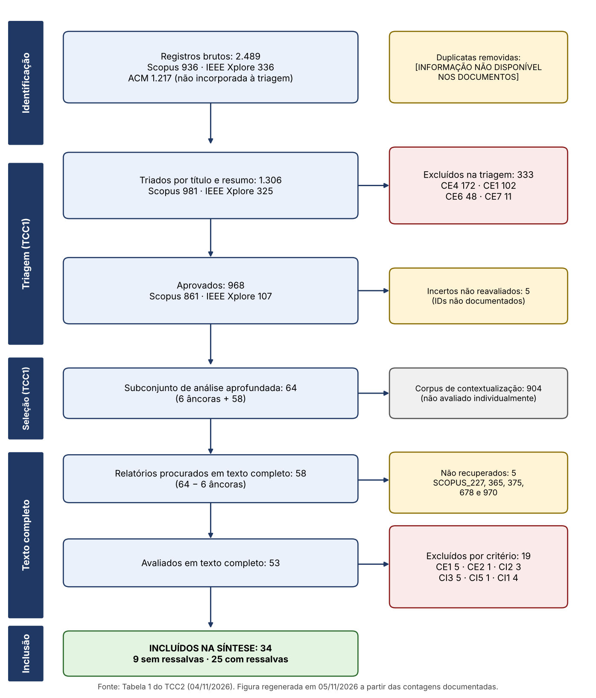

# Fluxo de seleção (PRISMA 2020)

Extraído sem alteração da Seção 4.1 do TCC2 (versão de 04/11/2026). A figura foi regenerada em 05/11/2026 a partir destas contagens (o arquivo original `figs/fig1_prisma.png` citado no TCC2 não estava disponível).

**Tabela 1 – Fluxo de seleção (PRISMA 2020)**

| Fase | Etapa | n |
|---|---|---|
| Identificação | Registros brutos (Scopus 936; IEEE Xplore 336; ACM 1.217, não incorporada à triagem) | 2.489 |
| Identificação | Duplicatas removidas | [INFORMAÇÃO NÃO DISPONÍVEL NOS DOCUMENTOS FORNECIDOS] |
| Triagem (TCC1) | Registros triados por título e resumo (Scopus 981; IEEE Xplore 325) | 1.306 |
| Triagem (TCC1) | Excluídos na triagem (CE4 172; CE1 102; CE6 48; CE7 11) | 333 |
| Triagem (TCC1) | Incertos não reavaliados | 5 |
| Triagem (TCC1) | Aprovados (Scopus 861; IEEE Xplore 107) | 968 |
| Seleção (TCC1) | Subconjunto de análise aprofundada (6 âncoras + 58) | 64 |
| Seleção (TCC1) | Corpus de contextualização | 904 |
| Texto completo | Relatórios procurados (64 − 6 âncoras) | 58 |
| Texto completo | Não recuperados (SCOPUS_227, 365, 375, 678, 970) | 5 |
| Texto completo | Avaliados | 53 |
| Texto completo | Excluídos por critério (CE1 5; CE2 1; CI2 3; CI3 5; CI5 1; CI1 4) | 19 |
| Inclusão | **Estudos incluídos na síntese** | **34** |
| Inclusão | Sem ressalvas / com ressalvas | 9 / 25 |

Conferência aritmética: 968 + 333 + 5 = 1.306; 6 + 58 = 64; 64 − 6 = 58; 53 + 5 = 58; 19 + 34 = 53; 9 + 25 = 34.

Conferências aritméticas recalculadas: `03_dados/TCC2_Planilha_Auditoria.xlsx`, aba `3_Fluxo_PRISMA` (fórmulas).
